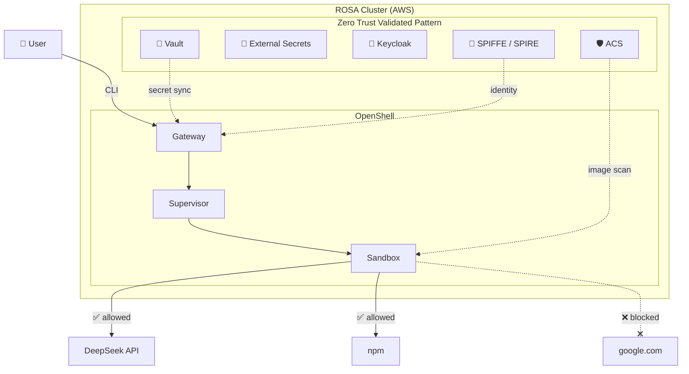
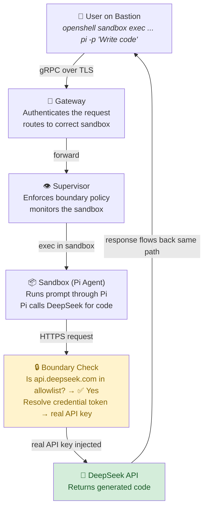
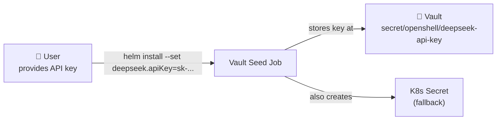
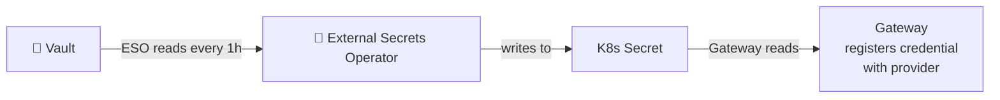
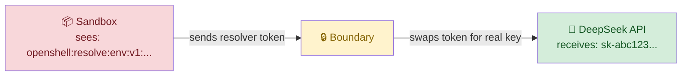
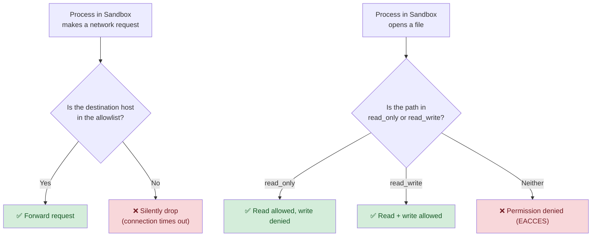

# Architecture

## Overall System Architecture

The demo runs on a ROSA cluster with the Zero Trust Validated Pattern (ZTVP) as the foundation. OpenShell is deployed as a Helm chart on top.

## Request Flow

When a user asks Pi to write code, the request passes through four layers before reaching the LLM.

**Key point:** The sandbox never sends the real API key. The Boundary intercepts the request, swaps the resolver token for the real key, and forwards it. The response travels back the same path.

## Credential Flow

API keys are **never visible** inside the sandbox. They pass through three phases:

**Phase 1 — Install time** (Helm chart hooks)

**Phase 2 — Runtime sync** (ESO keeps secrets fresh)

**Phase 3 — Every API call** (Boundary resolves at the edge)

> The sandbox **never** handles the real key. Even if compromised, the resolver token is useless outside the OpenShell boundary.

## Zero Trust Policy Enforcement

Every outbound request is checked. There is no default-allow.

## Components Summary

| Component | Role | Namespace |
|-----------|------|-----------|
| **OpenShell Gateway** | gRPC API, policy engine, credential resolver | `openshell-system` |
| **Supervisor** | Monitors sandbox, enforces boundary | `openshell-system` |
| **Sandbox** | Isolated container running Pi agent | `openshell-system` |
| **Vault** | Stores API keys, issues dynamic secrets | `vault` |
| **ESO** | Syncs Vault secrets → K8s Secrets | `external-secrets-operator` |
| **SPIFFE/SPIRE** | Issues cryptographic workload identities (SVIDs) | `spire-server` |
| **ACS** | Scans container images for CVEs, enforces policies | `stackrox` |
| **Keycloak** | SSO / OIDC identity provider | `keycloak-system` |
