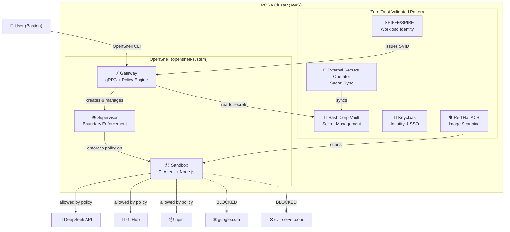
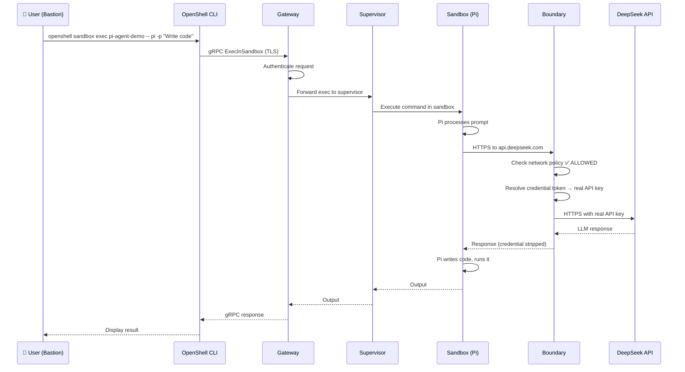
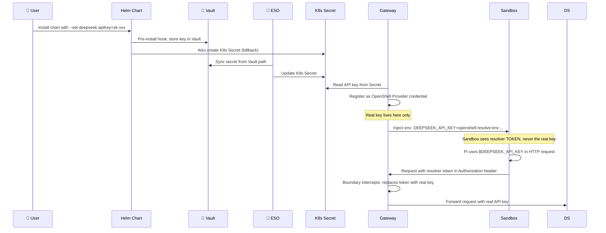
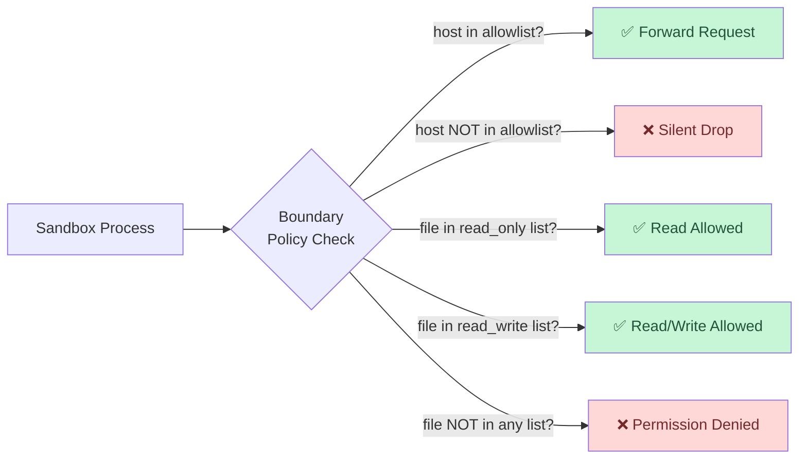

# Architecture

## Overall System Architecture

The demo runs on a ROSA cluster with the Zero Trust Validated Pattern (ZTVP) as the foundation. OpenShell is deployed as a Helm chart on top.

## Request Flow: User → Agent → LLM

When a user asks Pi to write code, this is the complete request flow:

## Credential Flow: API Key → Vault → Sandbox

API keys are **never visible** inside the sandbox. Here is how they flow:

## Zero Trust Policy Enforcement

Every network request and filesystem access is checked against the policy:

## Components Summary

| Component | Role | Namespace |
|-----------|------|-----------|
| **OpenShell Gateway** | gRPC API, policy engine, credential resolver | `openshell-system` |
| **Supervisor** | Monitors sandbox, enforces boundary | `openshell-system` |
| **Sandbox** | Isolated container running Pi agent | `openshell-system` |
| **Vault** | Stores API keys, issues dynamic secrets | `vault` |
| **ESO** | Syncs Vault secrets → K8s Secrets | `external-secrets-operator` |
| **SPIFFE/SPIRE** | Issues cryptographic workload identities (SVIDs) | `spire-server` |
| **ACS** | Scans container images for CVEs, enforces policies | `stackrox` |
| **Keycloak** | SSO / OIDC identity provider | `keycloak-system` |
