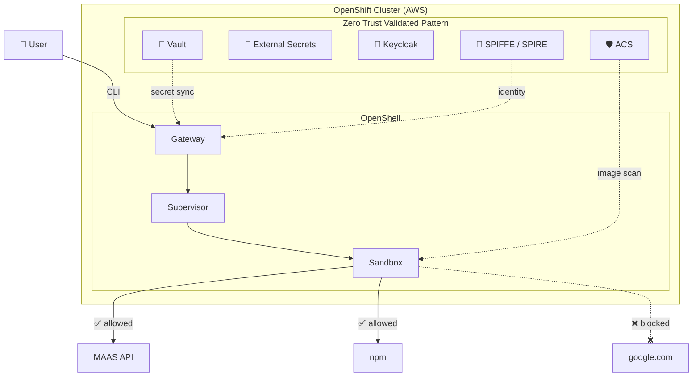
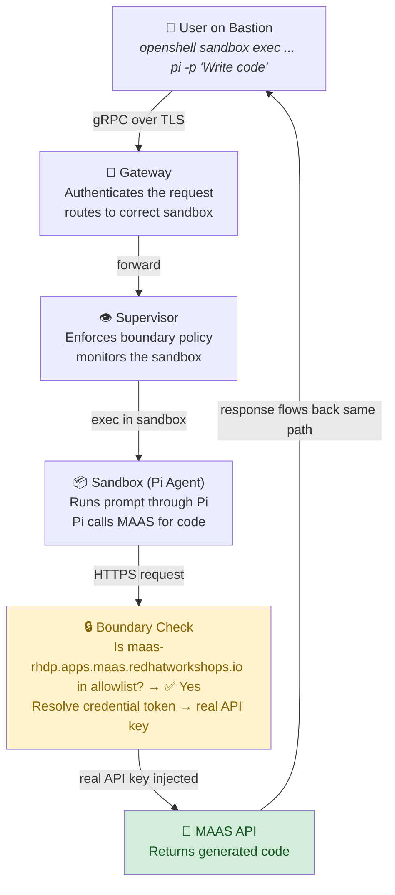
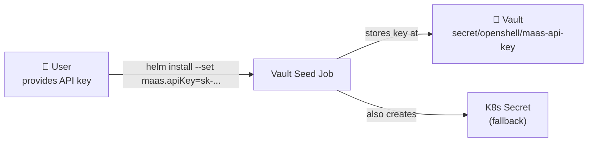
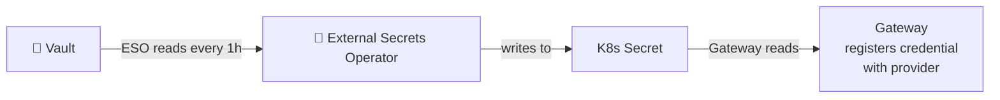
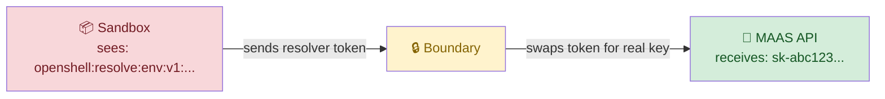
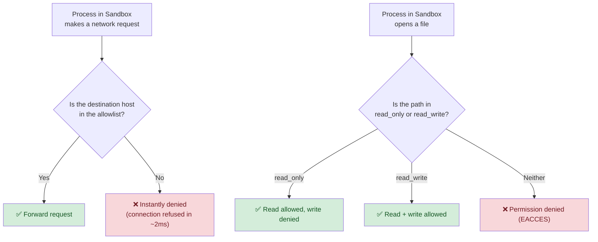

# Architecture

Before we start deploying, let's understand how all the pieces fit together. This module is **read-only** — no commands to run, just context that will make every later step make sense.

## The Big Picture

The demo runs on an **OpenShift cluster on AWS** with two layers:

1. **Foundation layer: ZTVP** — The Zero Trust Validated Pattern provides five security services (Vault, ESO, Keycloak, SPIFFE/SPIRE, ACS) that are already deployed and running. Think of ZTVP as the "security platform" that any application can plug into.

2. **Application layer: OpenShell** — NVIDIA's AI agent framework, deployed as a Helm chart on top of ZTVP. OpenShell adds the sandbox, the policy engine, and the credential resolver.

**Reading the diagram:**
- The **User** (you, on the bastion) sends commands via the OpenShell CLI to the **Gateway**
- The Gateway forwards to the **Supervisor**, which manages the **Sandbox** (where Pi runs)
- The Sandbox can reach **MAAS** and **npm** (green arrows) but **not** google.com (red X)
- ZTVP components (dotted arrows) provide secrets, identity, and image scanning behind the scenes

## What Is a "Sandbox"?

In OpenShell, a **sandbox** is an isolated container where an AI agent runs. It's similar to a Kubernetes pod, but with extra security layers:

| Feature | Regular K8s Pod | OpenShell Sandbox |
|---------|----------------|-------------------|
| Network access | Unrestricted (unless NetworkPolicy) | **Default-deny** — only explicit allowlist |
| Filesystem access | Full container filesystem | **Landlock LSM** — only listed paths |
| Credentials | Mounted as env vars or files (real values) | **Resolver tokens** — real keys never enter |
| Binary restrictions | None | Per-endpoint binary allowlists |
| Policy updates | Requires pod restart | **Live updates** via CLI |

The sandbox is where Pi lives. Everything Pi does — every file it writes, every network call it makes — is governed by the sandbox's policy.

## Request Flow

When you ask Pi to write code, here's what happens step by step:

**Walking through it:**

1. **You type a command** on the bastion: `openshell sandbox exec pi-agent-demo -- pi -p "Write code"`
2. The CLI sends a **gRPC request** (a high-performance RPC protocol) over **TLS** (encrypted) to the Gateway
3. The **Gateway** authenticates your request and finds the right sandbox
4. The **Supervisor** — a process that runs *outside* the sandbox and monitors it — receives the command
5. The Supervisor **executes** your command inside the sandbox. Pi starts running.
6. Pi calls MAAS. The HTTPS request hits the **Boundary** (the Supervisor's network filter)
7. The Boundary checks: "Is `maas-rhdp.apps.maas.redhatworkshops.io` in the allowlist?" → **Yes**. It also swaps the resolver token for the real API key.
8. The request reaches **MAAS**, which returns generated code
9. The response flows back the same path to your terminal

**The critical insight:** The sandbox never sends the real API key. The Boundary intercepts the request, swaps the resolver token for the real key, and forwards it. If the sandbox were compromised, the attacker would only have a useless token.

## Credential Flow

API keys are **never visible** inside the sandbox. They pass through three phases:

**Phase 1 — Install time** (when you install the Helm chart)

Your MAAS API key goes into **Vault** (HashiCorp's secret management system) via a Kubernetes Job that runs before anything else starts. Vault encrypts it at rest and controls who can access it.

**Phase 2 — Runtime sync** (ESO keeps secrets fresh)

The **External Secrets Operator** (ESO) watches Vault and automatically syncs the key into a Kubernetes Secret. The Gateway reads this Secret and registers it as a "provider credential." This sync happens every hour, so if you rotate the key in Vault, it propagates automatically.

**Phase 3 — Every API call** (Boundary resolves at the edge)

When Pi makes an API call, the `Authorization` header contains a **resolver token** (like `openshell:resolve:env:v123_MAAS_API_KEY`). The Boundary intercepts this, looks up the real key, and replaces the token before the request leaves the cluster. The sandbox never touches the real key.

> **Why this matters:** Even if an attacker compromises the sandbox, they get a resolver token that is (a) bound to a specific endpoint, (b) only resolvable inside the cluster boundary, and (c) useless anywhere else.

## Zero Trust Policy Enforcement

Every outbound request is checked. There is no default-allow.

**Two enforcement mechanisms work together:**

1. **Network policy** (enforced by the Supervisor/Boundary): Controls which hosts the sandbox can reach, down to the specific binary making the call. This is *not* a Kubernetes NetworkPolicy — it's enforced by OpenShell at the process level.

2. **Filesystem policy** (enforced by Landlock LSM): Controls which paths the sandbox can read/write. **Landlock** is a Linux kernel security module — it's enforced by the kernel itself, not by userspace code. This means even if the sandboxed process has root privileges, it *still* cannot access restricted paths.

## Components Summary

| Component | What it is | Role in this demo | Namespace |
|-----------|-----------|-------------------|-----------|
| **OpenShell Gateway** | gRPC API server | Receives CLI commands, resolves credentials, applies policy | `openshell-system` |
| **Supervisor** | Sidecar process | Runs outside the sandbox, enforces the network boundary, monitors the agent | `openshell-system` |
| **Sandbox** | Isolated container | Where Pi runs — the agent's entire world | `openshell-system` |
| **Vault** | Secret management (HashiCorp) | Stores and encrypts the MAAS API key | `vault` |
| **ESO** | External Secrets Operator | Syncs secrets from Vault → Kubernetes Secrets automatically | `external-secrets` |
| **SPIFFE/SPIRE** | Workload identity framework | Issues cryptographic certificates (SVIDs) to prove workload identity | `zero-trust-workload-identity-manager` |
| **ACS** | Advanced Cluster Security (StackRox) | Scans container images for CVEs, enforces security policies | `stackrox` |
| **Keycloak** | Identity provider (SSO/OIDC) | Authenticates users, issues JWT tokens | `keycloak-system` |

## What Makes This "Zero Trust"?

Traditional security trusts the network perimeter. Zero Trust trusts nothing:

| Traditional | Zero Trust (this lab) |
|------------|----------------------|
| "Inside the cluster = trusted" | Every request is verified |
| Credentials in env vars | Credentials never enter the sandbox |
| Network access: allow by default | Network access: deny by default |
| Filesystem: full access | Filesystem: kernel-enforced allowlist |
| Identity: "you're in the right namespace" | Identity: cryptographic SPIFFE certificates |
| Image security: scan once at build | Image security: continuous scanning by ACS |

## Next Step

Now that you understand the architecture, let's verify your environment is ready.

Proceed to: **Prerequisites** →
