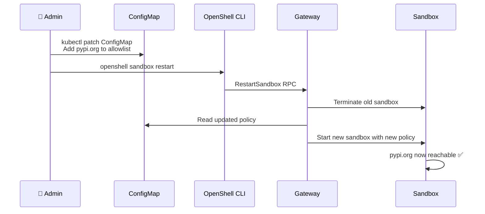

# Dynamic Policy

In this module you will update the zero-trust policy live — adding a new allowed endpoint and verifying the change takes effect without restarting the sandbox.

## Why Dynamic Policy?

In the real world, AI agents need evolving capabilities. A new API, a new package registry, a new data source. Rather than redeploying the entire chart, OpenShell supports updating the policy ConfigMap and reloading it.

## Current Policy State

Recall the current network policy:

| Host | Status |
|------|--------|
| `api.deepseek.com` | ✅ Allowed |
| `registry.npmjs.org` | ✅ Allowed |
| `github.com` | ✅ Allowed |
| `pypi.org` | ❌ Denied |

## Step 1 — Confirm pypi.org Is Blocked

Enter the sandbox and verify:

```bash
openshell sandbox exec pi-agent-demo -- bash
```

```bash
curl -s -o /dev/null -w "HTTP %{http_code}\n" --max-time 5 https://pypi.org/simple/requests/
```

Expected:

```
curl: (28) Connection timed out after 5001 milliseconds
```

❌ `pypi.org` is not in the allowlist. The agent cannot install Python packages.

```bash
exit
```

## Step 2 — Update the Policy ConfigMap

From the bastion, edit the policy ConfigMap to add `pypi.org`:

```bash
oc get configmap pi-sandbox-policy -n openshell-system -o yaml > /tmp/policy-backup.yaml
```

**Why:** Always back up the current policy before modifying it. This lets you revert if something goes wrong.

Now patch the ConfigMap to add pypi.org:

```bash
oc get configmap pi-sandbox-policy -n openshell-system -o json | \
  python3 -c "
import sys, json, yaml

cm = json.load(sys.stdin)
policy_key = [k for k in cm['data'].keys() if 'policy' in k.lower() or k.endswith('.yaml')][0]
policy = yaml.safe_load(cm['data'][policy_key])

# Add pypi.org to network policies
net = policy.get('network', {}).get('policies', [])
if not any(p.get('host') == 'pypi.org' for p in net):
    net.append({
        'name': 'pypi_registry',
        'protocol': 'tcp',
        'host': 'pypi.org',
        'port': 443,
        'action': 'allow'
    })
    policy['network']['policies'] = net
    cm['data'][policy_key] = yaml.dump(policy, default_flow_style=False)
    print(json.dumps(cm))
" | oc apply -f -
```

**Why:** This adds `pypi.org:443` to the network allowlist. The Python script safely parses the YAML, adds the entry only if it does not already exist, and applies the update.

## Step 3 — Trigger Policy Reload

The policy ConfigMap change does not automatically reload. Restart the sandbox to pick up the new policy:

```bash
openshell sandbox restart pi-agent-demo
```

**Why:** OpenShell reads the policy at sandbox startup. To apply a ConfigMap change, the sandbox must be restarted. This is a deliberate design choice — policy changes are auditable events, not silent background updates.

Wait for the sandbox to be ready again:

```bash
openshell sandbox list
```

Wait until `READY` shows `true`.

## Step 4 — Verify pypi.org Is Now Allowed

```bash
openshell sandbox exec pi-agent-demo -- bash
```

```bash
curl -s -o /dev/null -w "HTTP %{http_code}\n" --max-time 5 https://pypi.org/simple/requests/
```

Expected:

```
HTTP 200
```

✅ `pypi.org` is now allowed! The agent can install Python packages.

## Step 5 — Test Python Package Installation

```bash
pip install requests 2>&1 | tail -3
```

Expected:

```
Successfully installed requests-x.x.x ...
```

```bash
exit
```

## Policy Change Flow



## Step 6 — Revert the Policy (Optional)

To remove the pypi.org entry and restore the original policy:

```bash
oc apply -f /tmp/policy-backup.yaml
openshell sandbox restart pi-agent-demo
```

## Key Takeaways

| Aspect | Detail |
|--------|--------|
| Policy storage | Kubernetes ConfigMap — GitOps-friendly |
| Policy format | YAML — human-readable, auditable |
| Update mechanism | Edit ConfigMap → restart sandbox |
| Audit trail | ConfigMap changes are logged by the K8s API audit log |
| No downtime | Sandbox restarts in seconds |

## Next Step

You've completed all the demo scenarios. Next, clean up the environment.

Proceed to: **Cleanup** →
