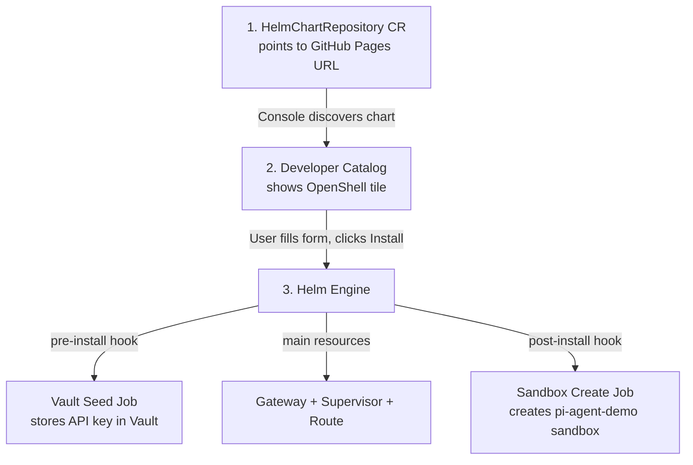
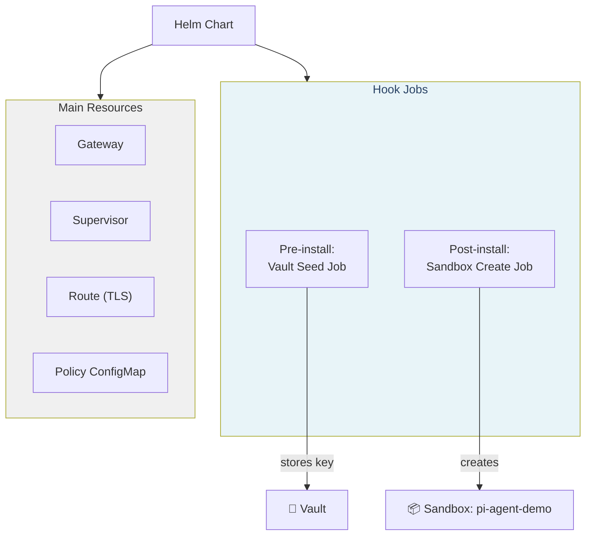

# Deploy from the OpenShift Developer Catalog

In this module you will install OpenShell as a **Helm chart** directly from the OpenShift Console — or via the CLI. Either way, it's a one-step deployment that creates everything: the Gateway, the Supervisor, the sandbox, and all the ZTVP integrations.

> **What is Helm?** Helm is a package manager for Kubernetes — think of it like `apt` or `brew`, but for cluster applications. A Helm "chart" bundles all the Kubernetes resources (Deployments, Services, ConfigMaps, etc.) needed to run an application. Instead of applying 15 YAML files one by one, you install one chart and everything is created in the right order.

## How It Works

The Helm chart is hosted on **GitHub Pages** (a static file server) and registered in the cluster as a `HelmChartRepository` custom resource. This makes it appear in the OpenShift **Developer Catalog** — a visual marketplace of installable applications.



**Reading the diagram:**
1. A `HelmChartRepository` CR tells OpenShift "there's a Helm repo at this URL"
2. The OpenShift Console discovers the chart and shows it in the Developer Catalog
3. When you click Install, the Helm engine runs three phases in order:
   - **Pre-install hook**: A Job that stores your MAAS API key in Vault *before* anything else starts
   - **Main resources**: The Gateway, Supervisor, Route, and ConfigMaps
   - **Post-install hook**: A Job that creates the sandbox, imports the MAAS provider, and configures Pi

> **What are Helm hooks?** Hooks are Kubernetes Jobs that run at specific lifecycle points (pre-install, post-install, pre-delete, etc.). They're perfect for setup/teardown tasks that must happen in a specific order. In our case, the API key *must* be in Vault before the Gateway tries to read it.

## Step 1 — Register the Chart Repository

The chart repository must be registered once per cluster. SSH to the bastion and run:

```bash
ssh lab-user@<BASTION_HOST>
```

Apply the `HelmChartRepository` custom resource:

```bash
cat <<'EOF' | oc apply -f -
apiVersion: helm.openshift.io/v1beta1
kind: HelmChartRepository
metadata:
  name: openshell-ztm-demo
spec:
  connectionConfig:
    url: https://avijra.github.io/openshell-ztm-demo-chart/
  name: OpenShell ZTM Demo
EOF
```

> **What does this do?** This creates a Kubernetes custom resource that tells OpenShift: "There is a Helm chart repository at `https://avijra.github.io/openshell-ztm-demo-chart/`. Please check its `index.yaml` file and show any charts you find in the Developer Catalog." Without this CR, the chart would be invisible to the Console.

Verify the CR was created:

```bash
oc get helmchartrepositories openshell-ztm-demo
```

Expected:

```
NAME                  AGE
openshell-ztm-demo    5s
```

## Step 2 — Create the Namespace

The Helm chart expects a dedicated namespace. Create it before installing from the Console:

```bash
oc create namespace openshell-system
```

> **Why create it first?** The CLI command (`helm install --create-namespace`) creates the namespace automatically, but the OpenShift Console form does not. Creating it upfront avoids install errors regardless of which method you use.

## Step 3 — Open the Developer Catalog

1. Open the **OpenShift Console** in your browser:

   ```
   https://console-openshift-console.<CLUSTER_DOMAIN>
   ```

2. Switch to the **Developer** perspective (top-left dropdown — it might say "Administrator" by default)

   > **Developer perspective not visible?** On some OCP 4.14+ clusters, the Developer perspective is not enabled by default. To enable it: go to **Administration → Cluster Settings → Configuration → Console (operator.openshift.io)**, then under **Customization** ensure the Developer perspective is enabled. Alternatively, you can install entirely from the CLI (see the "Prefer CLI?" box in Step 4).

3. Click **+Add** in the left sidebar

4. Click **Helm Chart** under the catalog section

5. In the search bar, type **openshell**

6. You should see the **OpenShell ZTM Demo** chart tile

> **What is the Developer Catalog?** It's a visual interface in OpenShift where developers can browse and install pre-packaged applications. Think of it like an app store for your cluster. Charts, Operators, and templates all appear here.

## Step 4 — Install the Chart

1. Click the **OpenShell ZTM Demo** tile

2. Click **Install Helm Chart**

3. Switch to **Form view** (the UI form, not raw YAML)

4. Fill in the form:

   | Field | Value | Why |
   |-------|-------|-----|
   | **Release Name** | `openshell-ztm-demo` | A unique name for this installation. Helm uses it to track what it created. |
   | **Namespace** | `openshell-system` | Select the namespace you created in Step 2 |
   | **MAAS > Enabled** | ✅ checked | Enable the MAAS LLM provider (gpt-oss-120b) so Pi can generate code |
   | **MAAS > API Key** | `<MAAS_API_KEY>` | Your personal MAAS key — it will be stored in Vault, not as plain text |
   | **Vault > Enabled** | ✅ checked | Store the API key in Vault (ZTVP integration) instead of just a K8s Secret |

   Leave all other fields at their defaults.

5. Click **Install**

   > **Prefer CLI?** You can also install from the bastion with:
> ```bash
> helm repo add openshell-ztm-demo https://avijra.github.io/openshell-ztm-demo-chart/
> helm install openshell-ztm-demo openshell-ztm-demo/openshell-ztm-demo \
>   -n openshell-system --create-namespace \
>   --set maas.apiKey=<MAAS_API_KEY> \
>   --set vault.enabled=true \
>   --set global.clusterDomain=<CLUSTER_DOMAIN> \
>   --set keycloak.adminSecretName=keycloak-admin-user \
>   --set keycloak.adminUsername=admin
> ```
> The `--create-namespace` flag creates the namespace automatically, so you can skip Step 2 if using the CLI.

## Step 5 — Watch the Deployment

The installation takes 1–2 minutes. During this time, three things happen in order:

**Phase 1: Pre-install hooks run first**

A Kubernetes Job called `vault-seed-maas` starts. It:
- Authenticates to Vault using the Kubernetes auth method (path `hub/`)
- Writes your MAAS API key to Vault at path `hub/infra/openshell/maas`
- Also creates a Kubernetes Secret as a fallback

This happens *before* any OpenShell pods start, ensuring the key is in Vault when the Gateway needs it.

**Phase 2: Main resources deploy**

- **OpenShell Gateway** (StatefulSet) — the gRPC API server that receives CLI commands
- **Supervisor** — monitors the sandbox and enforces the boundary policy
- **Route** — an OpenShift Route that exposes the Gateway over HTTPS
- **Policy ConfigMap** — the zero-trust network + filesystem rules

> **What is a StatefulSet?** Unlike a Deployment (which creates interchangeable pods), a StatefulSet gives each pod a stable identity and persistent storage. The Gateway is a StatefulSet because it maintains state about sandboxes and providers.

**Phase 3: Post-install hook runs last**

A Job called `pi-sandbox-setup` starts. It:
- Creates the `pi-agent-demo` sandbox (a container with Pi v1.4.0 and Node.js 22)
- Imports the MAAS provider profile (tells Pi how to talk to the MAAS LLM)
- Registers the MAAS provider with the credential from Vault

Watch the pods come up from the bastion:

```bash
oc get pods -n openshell-system -w
```

> **The `-w` flag** means "watch" — the output updates in real-time as pods change status. Press `Ctrl+C` to stop watching.

Wait until you see all pods in `Running` state and the setup job in `Completed`:

```
NAME                                                 READY   STATUS      RESTARTS   AGE
default--pi-agent-demo                               1/1     Running     0          1m
keycloak-client-setup-1-xxxxx                        0/1     Completed   0          1m
openshell-ztm-demo-0                                 1/1     Running     0          1m
os-supervisor-xxxxxxxx-xxxx-xxxx-xxxx-xxxxxxxxxxxx   1/1     Running     0          1m
pi-sandbox-setup-1-xxxxx                             0/1     Completed   0          1m
```

**Understanding each pod:**

| Pod | What it is | Why it matters |
|-----|-----------|----------------|
| `openshell-ztm-demo-0` | **Gateway** (StatefulSet, hence the `-0` suffix) | The brain — receives your CLI commands, manages sandboxes, resolves credentials |
| `os-supervisor-*` | **Supervisor** | Runs *outside* the sandbox, enforces the network boundary. If the sandbox tries to reach google.com, the Supervisor blocks it. |
| `default--pi-agent-demo` | **Sandbox** | Where Pi lives and runs. The `default--` prefix means it's in the `default` workspace. |
| `keycloak-client-setup-1-*` | **Keycloak Client Job** (completed) | One-time job that creates or updates the `openshell-gateway` OIDC client in Keycloak via the Admin REST API. `Completed` means the client is configured. |
| `pi-sandbox-setup-1-*` | **Setup Job** (completed) | One-time job that created the sandbox and configured the provider. `Completed` means it finished successfully. |

## Step 6 — Verify the Sandbox

Confirm the sandbox pod is running:

```bash
oc get pod default--pi-agent-demo -n openshell-system
```

Expected output:

```
NAME                     READY   STATUS    RESTARTS   AGE
default--pi-agent-demo   1/1     Running   0          2m
```

> **What does `1/1 Running` mean?** The pod has 1 container requested and 1 container running. `Running` means the Gateway has provisioned the sandbox, the Supervisor is connected, and the zero-trust policy is actively enforced. The agent is ready to accept commands. Pi is configured to use MAAS (gpt-oss-120b) as its default LLM provider.

## What Just Happened

Let's trace exactly what the chart created:



| Resource | What it is | Why it exists |
|----------|-----------|--------------|
| **Namespace** | `openshell-system` | Isolates all OpenShell resources from the rest of the cluster |
| **Gateway** | StatefulSet + Service | The API server that manages everything. It speaks gRPC, resolves credentials, and stores sandbox state. |
| **Supervisor** | Pod managed by Gateway | Sits between the Gateway and the Sandbox. Enforces the network boundary — every outbound request from the sandbox passes through the Supervisor first. |
| **Route** | OpenShift Route (HTTPS) | Exposes the Gateway to the outside world. The OpenShell CLI connects to this URL. |
| **Policy ConfigMap** | YAML configuration | Contains the network rules (which hosts are allowed) and filesystem rules (which paths are accessible). This is the "policy" that defines what the agent can and cannot do. |
| **Vault Seed Job** | Pre-install hook Job | Stores your MAAS API key in Vault before anything else starts. Runs once and completes. |
| **Sandbox Create Job** | Post-install hook Job | Creates the `pi-agent-demo` sandbox, imports the MAAS provider profile, and registers the credential. Runs once and completes. |

## Troubleshooting

**Chart not visible in Catalog?**

```bash
oc get helmchartrepositories openshell-ztm-demo -o yaml
```

Check that `status.conditions` shows `Ready=True`. If not, verify the GitHub Pages URL returns HTTP 200:

```bash
curl -s -o /dev/null -w "%{http_code}" https://avijra.github.io/openshell-ztm-demo-chart/index.yaml
```

**Pods stuck in Pending?**

This usually means the cluster doesn't have enough CPU/memory. Check:

```bash
oc describe pod -n openshell-system -l app=openshell-gateway
```

Look for `Events` at the bottom — they'll tell you if the scheduler can't find a node.

**Vault seed job failed?**

```bash
oc logs -n openshell-system job/vault-seed-maas-1
```

Common cause: Vault is sealed or the Kubernetes auth path is wrong. The job authenticates to Vault using the `hub/` auth path.

## Next Step

The chart is deployed and the sandbox is running. Next, you'll configure the OpenShell CLI on the bastion so you can interact with the sandbox.

Proceed to: **Client Setup** →
