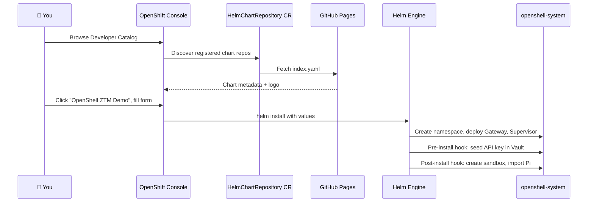
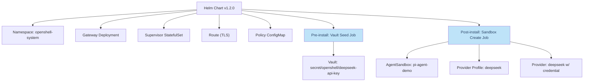

# Deploy from the OpenShift Developer Catalog

In this module you will install the OpenShell Zero Trust Demo as a Helm chart directly from the OpenShift Console — no CLI or YAML editing required.

## How It Works

The Helm chart is hosted on GitHub Pages and registered in the cluster as a `HelmChartRepository` custom resource. This makes it appear in the OpenShift Developer Catalog alongside other charts.



## Step 1 — Register the Chart Repository

The chart repository must be registered once per cluster. SSH to the bastion and run:

```bash
ssh rosa@<BASTION_HOST>
```

Apply the `HelmChartRepository` custom resource. This tells OpenShift where to find the chart:

```bash
cat <<'EOF' | oc apply -f -
apiVersion: helm.openshift.io/v1beta1
kind: HelmChartRepository
metadata:
  name: openshell-ztm-demo
spec:
  connectionConfig:
    url: https://avijra.github.io/openshell-ztm-demo-chart/
  name: OpenShell ZTM Demo
EOF
```

**Why:** OpenShift only shows Helm charts in the Developer Catalog if a `HelmChartRepository` resource points to a valid Helm repo (a URL serving `index.yaml`). Without this CR, the chart would not appear.

Verify the CR was created:

```bash
oc get helmchartrepositories openshell-ztm-demo
```

Expected:

```
NAME                  AGE
openshell-ztm-demo    5s
```

## Step 2 — Open the Developer Catalog

1. Open the OpenShift Console in your browser:

   ```
   https://console-openshift-console.<CLUSTER_DOMAIN>
   ```

2. Switch to the **Developer** perspective (top-left dropdown)

3. Click **+Add** in the left sidebar

4. Click **Helm Chart** under the catalog section

5. In the search bar, type **openshell**

6. You should see the **OpenShell ZTM Demo** chart with the NVIDIA OpenShell logo

## Step 3 — Install the Chart

1. Click the **OpenShell ZTM Demo** tile

2. Click **Install Helm Chart**

3. Switch to **Form view** (the UI form, not YAML)

4. Fill in the form:

   | Field | Value | Why |
   |-------|-------|-----|
   | **Release Name** | `openshell` | Identifies this Helm release |
   | **Namespace** | `openshell-system` | The chart creates this namespace |
   | **DeepSeek > Enabled** | ✅ checked | Enable the DeepSeek LLM provider |
   | **DeepSeek > API Key** | `<DEEPSEEK_API_KEY>` | Your personal DeepSeek key |
   | **Vault > Enabled** | ✅ checked | Store API key in Vault (ZTVP integration) |

   Leave all other fields at their defaults.

5. Click **Install**

## Step 4 — Watch the Deployment

The installation takes 2–3 minutes. During this time:

1. **Pre-install hooks run first:**
   - A Kubernetes Job seeds your DeepSeek API key into Vault at path `secret/data/openshell/deepseek-api-key`
   - This happens before any OpenShell pods start

2. **Main resources deploy:**
   - OpenShell Gateway (Deployment + Service + Route)
   - OpenShell Supervisor (StatefulSet)
   - Agent Sandbox CRD

3. **Post-install hook runs last:**
   - A Kubernetes Job creates the `pi-agent-demo` sandbox
   - It imports the DeepSeek provider profile
   - It registers the DeepSeek provider with the credential from Vault

Watch the pods come up from the bastion:

```bash
oc get pods -n openshell-system -w
```

Wait until you see all pods in `Running` state and the hook jobs in `Completed`:

```
NAME                                   READY   STATUS      RESTARTS   AGE
openshell-gateway-xxxxx-xxxxx          1/1     Running     0          2m
openshell-supervisor-0                 1/1     Running     0          2m
pi-agent-demo                          1/1     Running     0          1m
sandbox-create-job-xxxxx               0/1     Completed   0          1m
vault-seed-deepseek-1-xxxxx            0/1     Completed   0          2m
```

Press `Ctrl+C` to stop watching.

## Step 5 — Verify the Sandbox

Confirm the sandbox is ready:

```bash
oc get agentsandboxes -n openshell-system
```

Expected output:

```
NAME              READY   AGE
pi-agent-demo     True    2m
```

**Why:** The `AgentSandbox` is a Kubernetes Custom Resource (CR) managed by OpenShell. The `READY=True` status means the Gateway has provisioned the sandbox pod, the Supervisor is connected, and the zero-trust policy is enforced.

## What Just Happened

Let's trace exactly what the chart created:



| Resource | Purpose |
|----------|---------|
| **Namespace** | Dedicated namespace isolating OpenShell from other workloads |
| **Gateway** | gRPC API server, credential resolver, policy engine |
| **Supervisor** | Monitors sandbox lifecycle, enforces boundary |
| **Route** | TLS-terminated ingress for the Gateway gRPC endpoint |
| **Policy ConfigMap** | Zero-trust network + filesystem rules |
| **Vault Seed Job** | Stores the DeepSeek API key in Vault before anything else starts |
| **Sandbox Create Job** | Creates the sandbox, imports Pi, configures the provider |

## Troubleshooting

**Chart not visible in Catalog?**

```bash
oc get helmchartrepositories openshell-ztm-demo -o yaml
```

Check that `status.conditions` shows `Ready=True`. If not, verify the GitHub Pages URL returns HTTP 200:

```bash
curl -s -o /dev/null -w "%{http_code}" https://avijra.github.io/openshell-ztm-demo-chart/index.yaml
```

**Pods stuck in Pending?**

Check for resource quota or node capacity issues:

```bash
oc describe pod -n openshell-system -l app=openshell-gateway
```

**Vault seed job failed?**

```bash
oc logs -n openshell-system job/vault-seed-deepseek-1
```

Common cause: Vault is sealed or the auth path is wrong. The job uses Kubernetes auth at path `hub/`.

## Next Step

The chart is deployed and the sandbox is running. Next, you'll configure the OpenShell CLI on the bastion to interact with it.

Proceed to: **Client Setup** →
