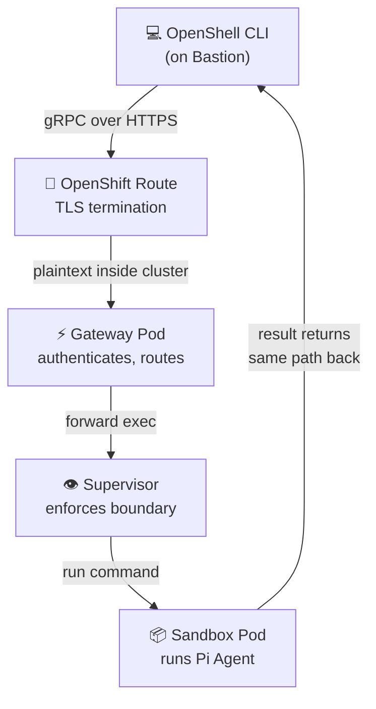

# Client Setup

In this module you will configure the OpenShell CLI on the bastion to communicate with the Gateway. This takes about 2 minutes.

## Why the Bastion?

The OpenShell Gateway is exposed via an **OpenShift Route** — a URL that terminates TLS and forwards traffic to the Gateway pod. The bastion host has direct network access to the cluster and already has both `oc` and `openshell` installed. This makes it the ideal place to run commands.

> **Could I run this from my laptop?** Yes — if your laptop can reach the cluster's Route URL, you can install the `openshell` CLI locally and point it at the same endpoint. The bastion is just convenient because everything is pre-configured.

## Step 1 — SSH to the Bastion

```bash
ssh lab-user@<BASTION_HOST>
```

## Step 2 — Check the OpenShell CLI

The OpenShell CLI should already be installed. Verify:

```bash
openshell --version
```

Expected output:

```
openshell 0.1.6
```

> **What is the OpenShell CLI?** It's a command-line tool (written in Rust) that communicates with the OpenShell Gateway via **gRPC** (Google Remote Procedure Call — a high-performance protocol used by many cloud-native tools). Think of it like `kubectl` for Kubernetes, but specifically for managing AI agent sandboxes.

> If `openshell` is not found, download it:
> ```bash
> curl -fsSL https://raw.githubusercontent.com/NVIDIA/OpenShell/main/install.sh | sh
> ```

## Step 3 — Configure the Gateway Endpoint

The CLI needs to know where the Gateway is. We'll read the Route hostname from OpenShift and set it as an environment variable:

```bash
export OPENSHELL_GATEWAY_ENDPOINT=https://$(oc get route openshell-ztm-demo -n openshell-system -o jsonpath='{.spec.host}')
echo "Gateway: $OPENSHELL_GATEWAY_ENDPOINT"
```

Expected output:

```
Gateway: https://openshell-ztm-demo-openshell-system.<CLUSTER_DOMAIN>
```

> **Breaking this down:**
> - `oc get route openshell-ztm-demo` — fetches the OpenShift Route resource created by the Helm chart
> - `-o jsonpath='{.spec.host}'` — extracts just the hostname from the Route's YAML
> - `https://` prefix — the CLI requires the full URL including the scheme. A bare hostname will be rejected.
> - The hostname follows OpenShift's convention: `{route-name}-{namespace}.{cluster-domain}`

Since the OpenShift Route uses a **cluster-internal CA certificate** (not a publicly trusted one like Let's Encrypt), we need to tell the CLI to skip certificate validation:

```bash
export OPENSHELL_GATEWAY_INSECURE=true
```

> **What does "insecure" mean here?** The traffic is still **encrypted** (TLS). The `insecure` flag only skips *certificate validation* — meaning the CLI won't reject the certificate just because it's signed by the cluster's internal CA instead of a public CA. In production, you would install a trusted certificate instead. This is similar to `curl -k` or `kubectl --insecure-skip-tls-verify`.

## Step 4 — Verify Connectivity

List the sandboxes registered with the Gateway:

```bash
openshell sandbox list
```

Expected output:

```
NAME           CREATED              PHASE
pi-agent-demo  2026-xx-xx xx:xx:xx  Ready
```

> **What does each column mean?**
> - **NAME**: The sandbox identifier. `pi-agent-demo` is the sandbox created by the Helm chart's post-install hook.
> - **CREATED**: When the sandbox was created.
> - **PHASE**: The sandbox's current state. `Ready` means the pod is running, the Supervisor is connected, and the zero-trust policy is active. The sandbox is ready to accept commands.

If you see `pi-agent-demo` with `Phase: Ready`, the CLI is correctly communicating with the Gateway.

## Step 5 — Make the Config Persistent

Add the environment variables to your shell profile so they survive new SSH sessions:

```bash
cat >> ~/.bashrc <<'EOF'

# OpenShell CLI configuration
export OPENSHELL_GATEWAY_ENDPOINT=https://$(oc get route openshell-ztm-demo -n openshell-system -o jsonpath='{.spec.host}')
export OPENSHELL_GATEWAY_INSECURE=true
EOF

source ~/.bashrc
```

> **Why `~/.bashrc`?** This file runs every time you open a new Bash session. By adding the exports here, you won't need to re-type them if you disconnect and reconnect to the bastion. The `source ~/.bashrc` line reloads it immediately.

## Connection Architecture

Here is the full path a command takes from your terminal to the sandbox:



**Step by step:**
1. The **CLI** sends a gRPC request over HTTPS to the OpenShift Route
2. The **Route** terminates TLS (decrypts the traffic) and forwards the plaintext request to the Gateway pod inside the cluster
3. The **Gateway** authenticates the request and routes it to the correct Supervisor
4. The **Supervisor** executes the command inside the sandbox container
5. The **Sandbox** runs the command (e.g., `pi -p "Write code"`) and streams output back
6. The response travels back the same path to your terminal

## Quick Reference

These two environment variables are all you need on any machine with network access to the cluster:

```bash
export OPENSHELL_GATEWAY_ENDPOINT=https://openshell-ztm-demo-openshell-system.<CLUSTER_DOMAIN>
export OPENSHELL_GATEWAY_INSECURE=true
```

## Next Step

The CLI is configured and connected. Time for the fun part — let's run the Pi coding agent inside the sandbox and watch it write real code.

Proceed to: **AI Agent Coding** →
