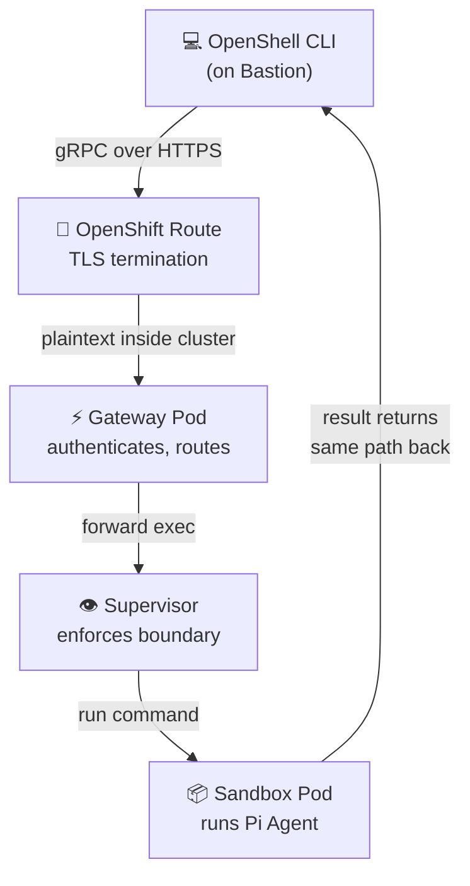

# Client Setup

In this module you will install the OpenShell CLI on the bastion and configure it to talk to the Gateway.

## Why the Bastion?

The OpenShell Gateway is exposed via an OpenShift Route inside the cluster. The bastion host has direct network access to the cluster and already has `oc` authenticated. This makes it the ideal client.

## Step 1 — SSH to the Bastion

```bash
ssh rosa@<BASTION_HOST>
```

## Step 2 — Download the OpenShell CLI

The OpenShell CLI is a single static binary. Download it from NVIDIA's CDN:

```bash
curl -fsSL https://openshell-cli.s3.amazonaws.com/v0.1.6/openshell-linux-amd64 -o /usr/local/bin/openshell
chmod +x /usr/local/bin/openshell
```

**Why:** The CLI is the primary interface for interacting with sandboxes. It communicates with the Gateway over gRPC. Version 0.1.6 matches the chart's bundled server version.

Verify the installation:

```bash
openshell version
```

Expected output:

```
openshell v0.1.6
```

## Step 3 — Configure the Gateway Endpoint

The CLI needs to know the Gateway's address. Get the Route hostname:

```bash
export OPENSHELL_GATEWAY_ENDPOINT=$(oc get route openshell-gateway -n openshell-system -o jsonpath='{.spec.host}')
echo "Gateway: $OPENSHELL_GATEWAY_ENDPOINT"
```

Expected output:

```
Gateway: openshell-gateway-openshell-system.apps.rosa.rosa-wjw4q.8pwg.p3.openshiftapps.com
```

**Why:** `OPENSHELL_GATEWAY_ENDPOINT` tells the CLI where to send gRPC requests. Without this, the CLI has no server to connect to.

Since the OpenShift Route uses a self-signed TLS certificate (not publicly trusted), set the insecure flag:

```bash
export OPENSHELL_GATEWAY_INSECURE=true
```

**Why:** The Gateway uses TLS (via the OpenShift Route), but the certificate is issued by the cluster's internal CA. Setting `OPENSHELL_GATEWAY_INSECURE=true` tells the CLI to skip certificate validation. In production, you would configure a trusted certificate instead.

## Step 4 — Verify Connectivity

List the sandboxes registered with the Gateway:

```bash
openshell sandbox list
```

Expected output:

```
NAME              READY   PROVIDERS
pi-agent-demo     true    deepseek
```

**What this tells you:**

| Field | Meaning |
|-------|---------|
| `NAME` | The sandbox identifier — this is the container running Pi |
| `READY` | `true` means the sandbox pod is running and the supervisor is connected |
| `PROVIDERS` | `deepseek` means the DeepSeek LLM provider is configured and the credential is available |

## Step 5 — Make the Config Persistent

Add the environment variables to your shell profile so they survive new sessions:

```bash
cat >> ~/.bashrc <<'EOF'

# OpenShell CLI configuration
export OPENSHELL_GATEWAY_ENDPOINT=$(oc get route openshell-gateway -n openshell-system -o jsonpath='{.spec.host}')
export OPENSHELL_GATEWAY_INSECURE=true
EOF

source ~/.bashrc
```

**Why:** Without this, you would need to re-export the variables every time you open a new SSH session.

## Connection Architecture

Here is how the CLI communicates with the sandbox:



## Quick Reference

Set these two environment variables on any machine with network access to the cluster:

```bash
export OPENSHELL_GATEWAY_ENDPOINT=openshell-gateway-openshell-system.<CLUSTER_DOMAIN>
export OPENSHELL_GATEWAY_INSECURE=true
```

Then you can use any `openshell` command.

## Next Step

The CLI is configured and connected to the Gateway. Next, you'll run the Pi coding agent inside the sandbox.

Proceed to: **AI Agent Coding** →
