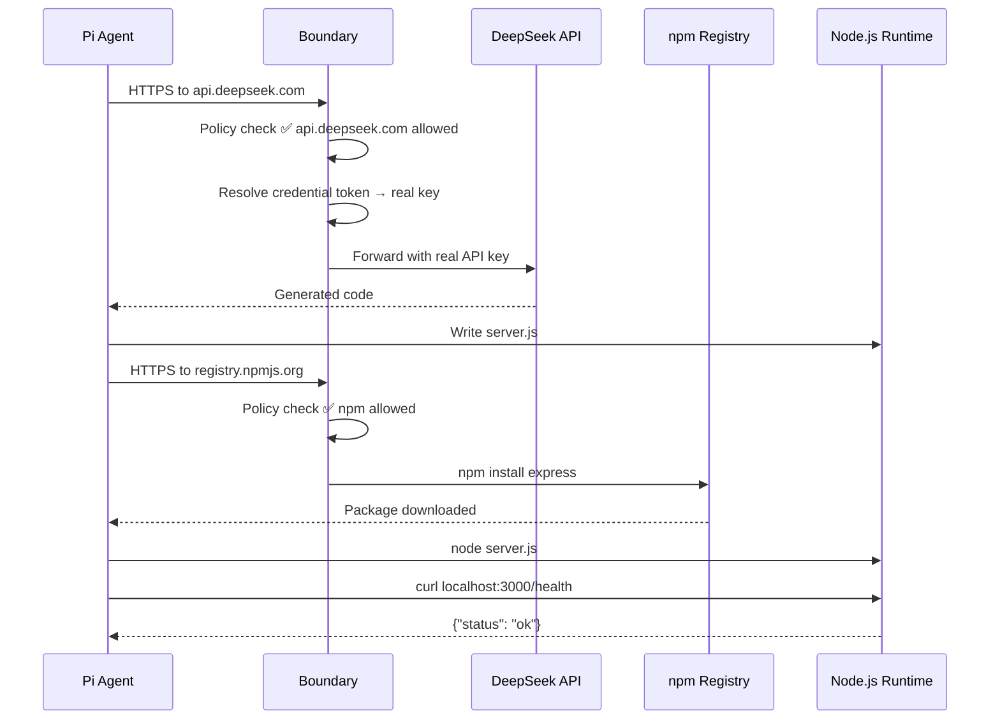

# AI Agent Coding with Pi + DeepSeek

In this module you will use the Pi coding agent inside the sandbox to write, run, and test real code — powered by DeepSeek LLM.

## What Is Pi?

**Pi** is NVIDIA's agentic coding assistant (Rust binary, v1.4.0). It:

- Takes natural language prompts
- Calls a configured LLM (DeepSeek) for code generation
- Writes files to disk
- Runs the generated code
- Iterates on errors until the code works

Pi runs **entirely inside the OpenShell sandbox**. Every network call it makes (to DeepSeek, to npm) goes through the OpenShell boundary, which enforces the zero-trust policy.

## Step 1 — Enter the Sandbox

From the bastion, open a shell inside the sandbox:

```bash
openshell sandbox exec pi-agent-demo -- bash
```

**Why:** `sandbox exec` runs a command inside the sandbox container, similar to `kubectl exec`. The `--` separates OpenShell flags from the command to run. You are now inside the sandboxed environment.

You should see a shell prompt:

```
sandbox@pi-agent-demo:~$
```

Verify Pi is available:

```bash
pi --version
```

Expected:

```
pi 1.4.0
```

## Step 2 — Simple Prompt: Hello World

Ask Pi to write a "Hello World" in Node.js:

```bash
pi -p "Create a Node.js script that prints Hello from the Zero Trust sandbox"
```

**Why:** The `-p` flag sends a one-shot prompt to Pi. Pi will:
1. Call DeepSeek to generate the code
2. Write it to a file (e.g., `hello.js`)
3. Run it with `node`
4. Show you the output

Expected behavior:

```
🤖 Writing hello.js...
📝 Running: node hello.js
Hello from the Zero Trust sandbox
```

> The exact output format varies, but you should see Pi writing a file and executing it successfully.

## Step 3 — Complex Prompt: REST API

Now ask Pi to build something more substantial:

```bash
pi -p "Create an Express.js REST API with these endpoints: GET /health returns {status: ok}, GET /items returns a list of 3 sample items, POST /items adds an item. Include error handling. Test it with curl."
```

**Why:** This demonstrates Pi's agentic capabilities — it will:
1. **Plan** the implementation
2. **Install dependencies** (`npm install express`) — network access to `registry.npmjs.org` is allowed by policy
3. **Write** the server code
4. **Start** the server
5. **Test** it with curl
6. **Show** the results

Watch as Pi:

- Downloads Express via npm (allowed by network policy)
- Creates the server file
- Starts the server
- Runs curl commands to test each endpoint
- Shows you the passing results

## What Happened Under the Hood



Every outbound network request was checked by the boundary:

| Request | Destination | Policy | Result |
|---------|-------------|--------|--------|
| LLM inference | `api.deepseek.com` | ✅ Explicitly allowed | Forwarded |
| npm install | `registry.npmjs.org` | ✅ Explicitly allowed | Forwarded |
| localhost test | `127.0.0.1:3000` | ✅ Local (no boundary) | Direct |

## Step 4 — Verify Provider Configuration

While still inside the sandbox, check the configured providers:

```bash
pi provider list
```

Expected:

```
NAME       MODEL
deepseek   deepseek-chat
```

**Why:** This confirms Pi knows about the DeepSeek provider and which model to use. The provider was configured by the Helm chart's post-install hook.

## Step 5 — Exit the Sandbox

```bash
exit
```

You are back on the bastion.

## Key Takeaways

| Observation | Significance |
|-------------|-------------|
| Pi wrote and ran real code | The agent has genuine capabilities inside the sandbox |
| npm install worked | Network policy selectively allows package registries |
| DeepSeek responded | Credential resolution happened transparently |
| All inside a sandbox | The agent never touched the host, cluster, or other namespaces |

## Next Step

You've seen what the agent **can** do. Next, you'll see what it **cannot** do — the network zero-trust boundary.

Proceed to: **Network Zero Trust** →
