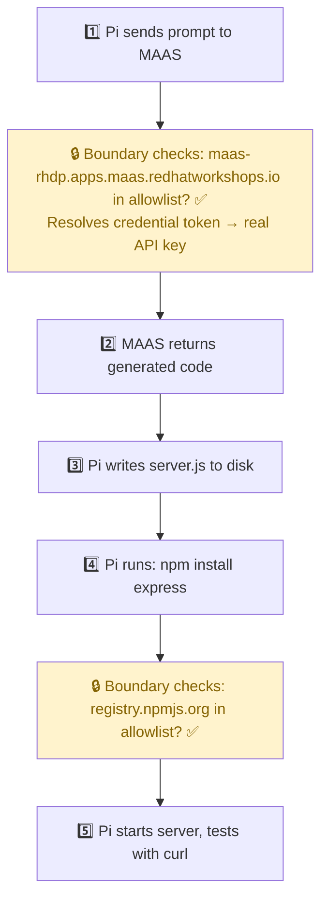

# AI Agent Coding with Pi + MAAS

In this module you will watch the Pi coding agent **write, run, and test real code** inside the sandbox — powered by the Red Hat MAAS LLM (gpt-oss-120b). This is the "wow" moment that shows what AI agents can do.

## What Is Pi?

**[Pi](https://pi.dev/)** is an agentic coding assistant by [Earendil Inc.](https://pi.dev/) Unlike ChatGPT or Copilot (which *suggest* code), Pi is **agentic** — it takes action:

| Capability | What it means |
|-----------|--------------|
| **Code generation** | Pi sends your prompt to MAAS LLM (gpt-oss-120b), which returns generated code |
| **File creation** | Pi writes the generated code to actual files on disk |
| **Dependency installation** | Pi runs `npm install` to fetch packages from the npm registry |
| **Code execution** | Pi runs the generated code with Node.js and shows you the output |
| **Error recovery** | If the code fails, Pi reads the error, asks MAAS for a fix, and tries again |

Pi is a Rust binary (v1.4.0) that runs entirely inside the OpenShell sandbox. Every network call it makes — to MAAS for code generation, to npm for packages — goes through the OpenShell boundary, which enforces the zero-trust policy.

> **What makes an agent different from a chatbot?** A chatbot generates text. An agent generates text *and takes actions*. Pi doesn't just suggest `npm install express` — it actually runs the command, handles errors, and verifies the result. This is why security matters: the agent has real capabilities, so we need real constraints.

## Step 1 — Enter the Sandbox

From the bastion, open a shell inside the sandbox:

```bash
openshell sandbox exec pi-agent-demo -- bash
```

> **What does this command do?**
> - `openshell sandbox exec` — execute a command inside a sandbox (similar to `kubectl exec`)
> - `pi-agent-demo` — the name of the sandbox (created by the Helm chart)
> - `--` — separator between OpenShell flags and the command to run
> - `bash` — open an interactive Bash shell inside the sandbox
>
> You are now **inside the sandbox**. Your prompt changes. Everything you type runs inside the sandboxed container, subject to the zero-trust policy.

Verify Pi is available:

```bash
pi --version
```

Expected:

```
1.4.0
```

## Step 2 — Simple Prompt: Hello World

Ask Pi to write a "Hello World" in Node.js:

```bash
pi -p "Create a Node.js script that prints Hello from the Zero Trust sandbox"
```

> **What does `-p` do?** The `-p` flag sends a one-shot prompt to Pi. Pi will:
> 1. Send your prompt to the **MAAS API** (the LLM) for code generation
> 2. Receive the generated code back
> 3. Write it to a file (e.g., `hello.js`)
> 4. Execute it with `node hello.js`
> 5. Show you the output
>
> All of this happens autonomously. You'll see Pi's thought process and actions in real time.

Expected behavior:

```
Created `/sandbox/hello.js` and verified it runs:

Hello from the Zero Trust sandbox
```

> The exact output format varies, but you should see Pi writing a file and executing it successfully. **This is an AI agent in action** — it didn't just suggest code, it wrote it, ran it, and verified it works.

## Step 3 — Complex Prompt: REST API

Now ask Pi to build something more substantial:

```bash
pi -p "Create an Express.js REST API with these endpoints: GET /health returns {status: ok}, GET /items returns a list of 3 sample items, POST /items adds an item. Include error handling. Test it with curl."
```

**Watch what happens.** Pi will autonomously:

1. **Plan** the implementation
2. **Initialize** a Node.js project with `npm init`
3. **Install dependencies** with `npm install express` — this downloads Express.js from `registry.npmjs.org`, which is allowed by the network policy
4. **Write** the server code to a file
5. **Start** the server in the background
6. **Test** each endpoint with curl
7. **Report** the results

> **Why is this impressive?** Pi is doing what a human developer would do — planning, coding, installing packages, testing — but fully autonomously. And critically, every network call (to MAAS for code, to npm for packages) was verified by the zero-trust boundary.

## What Happened Under the Hood

Pi performed these steps, and every outbound call went through the Boundary:



**Notice the yellow boxes** — those are the boundary checks. Every time a process inside the sandbox makes a network request, the Supervisor intercepts it and checks the policy:

| Request | Destination | Boundary Decision | Result |
|---------|-------------|-------------------|--------|
| LLM inference | `maas-rhdp.apps.maas.redhatworkshops.io` | ✅ In allowlist, `curl`/`node` are allowed binaries | Forwarded (with credential resolved) |
| npm install | `registry.npmjs.org` | ✅ In allowlist, `npm`/`node` are allowed binaries | Forwarded |
| curl localhost | `127.0.0.1:3000` | ✅ Localhost traffic doesn't leave the sandbox | Direct (no boundary) |

## Step 4 — Verify MAAS Credential Is Available

While still inside the sandbox, check the MAAS API key environment variable:

```bash
echo $MAAS_API_KEY | head -c 30
```

Expected (a resolver token, not the real key):

```
openshell:resolve:env:v...
```

> **What is this?** This is a **resolver token** — an opaque string that looks like `openshell:resolve:env:v1234567890_MAAS_API_KEY`. It is **not** your real MAAS API key (which starts with `sk-`). The real key never enters the sandbox. When Pi uses this token in an API call, the Boundary intercepts the request and swaps the token for the real key before forwarding it. We'll explore this in detail in the Credential Security module.

## Step 5 — Exit the Sandbox

```bash
exit
```

You are back on the bastion.

## Key Takeaways

| What you saw | Why it matters |
|-------------|---------------|
| Pi wrote and ran real code | The agent has genuine capabilities — it's not just a demo mockup |
| npm install worked | The network policy selectively allows package registries. Pi can install dependencies, but only from approved sources. |
| MAAS responded | Credential resolution happened transparently — Pi used a resolver token, the Boundary swapped it for the real key |
| Everything inside a sandbox | The agent never touched the host, the cluster, or other namespaces. It lives in an isolated world. |

## The Big Question

You've seen what the agent **can** do. But what about what it **cannot** do? What happens when Pi (or an attacker inside the sandbox) tries to reach Google, read system files, or steal the API key?

That's what the next three modules prove.

Proceed to: **Network Zero Trust** →
