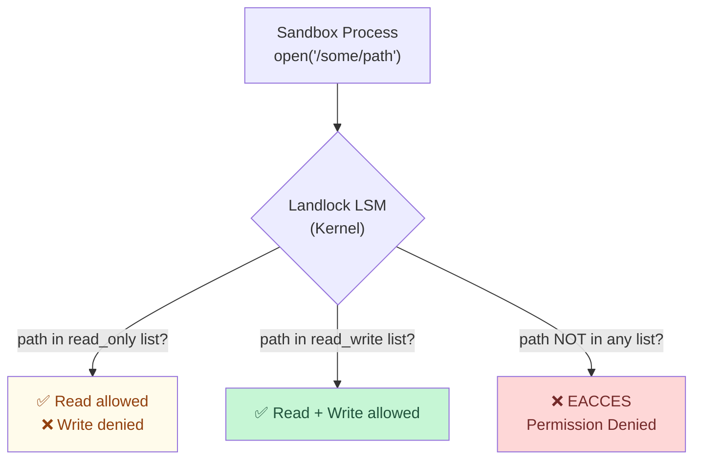

# Filesystem Zero Trust

In this module you will prove that the sandbox has **limited filesystem access**, enforced by Linux Landlock LSM. The agent can only read and write to paths explicitly allowed by the policy.

## The Filesystem Policy

The Helm chart deploys a Landlock filesystem policy:

```yaml
filesystem:
  read_only:
    - /usr
    - /lib
    - /etc/ssl
    - /etc/resolv.conf
  read_write:
    - /home/sandbox
    - /tmp
    - /workspace
```

| Path | Access | Why |
|------|--------|-----|
| `/usr`, `/lib` | Read-only | System binaries and libraries (node, python, curl) |
| `/etc/ssl` | Read-only | TLS certificates for HTTPS connections |
| `/etc/resolv.conf` | Read-only | DNS configuration |
| `/home/sandbox` | Read + Write | Agent's home directory — where Pi writes code |
| `/tmp` | Read + Write | Temporary files for builds, npm cache |
| `/workspace` | Read + Write | Working directory for projects |

Everything else — `/etc/passwd`, `/var`, `/root`, `/proc/1`, Kubernetes service account tokens — is **denied**.

## How Landlock LSM Works



**Landlock** is a Linux Security Module (LSM) that allows unprivileged processes to restrict their own filesystem access. Unlike AppArmor or SELinux, it does not require a privileged daemon. OpenShell configures Landlock rules when the sandbox starts, and the kernel enforces them — the process inside cannot remove or weaken these rules.

## Step 1 — Enter the Sandbox

```bash
openshell sandbox exec pi-agent-demo -- bash
```

## Step 2 — Test ALLOWED: Write to Home

```bash
echo "This is allowed" > /home/sandbox/test.txt
cat /home/sandbox/test.txt
```

Expected:

```
This is allowed
```

✅ **Allowed** — `/home/sandbox` is in the `read_write` list.

## Step 3 — Test ALLOWED: Write to /tmp

```bash
echo "Temp file" > /tmp/test.txt
cat /tmp/test.txt
```

Expected:

```
Temp file
```

✅ **Allowed** — `/tmp` is in the `read_write` list. npm and build tools use `/tmp` for caches.

## Step 4 — Test ALLOWED: Read System Binaries

```bash
ls /usr/bin/node
```

Expected:

```
/usr/bin/node
```

✅ **Allowed** — `/usr` is in the `read_only` list. The agent can execute programs but cannot modify them.

## Step 5 — Test DENIED: Write to /etc

```bash
echo "hacked" > /etc/test 2>&1
```

Expected:

```
bash: /etc/test: Permission denied
```

❌ **Denied** — `/etc` is not in the `read_write` list. Even though `/etc/ssl` and `/etc/resolv.conf` are readable, the agent cannot write to them.

## Step 6 — Test DENIED: Read /etc/passwd

```bash
cat /etc/passwd 2>&1
```

Expected:

```
cat: /etc/passwd: Permission denied
```

❌ **Denied** — `/etc/passwd` is not in the `read_only` list. Only `/etc/ssl` and `/etc/resolv.conf` are explicitly allowed.

## Step 7 — Test DENIED: Access Kubernetes Service Account

In a standard Kubernetes pod, every container has a service account token at `/var/run/secrets/kubernetes.io/serviceaccount/token`. An AI agent with access to this token could authenticate to the Kubernetes API and potentially escalate privileges.

```bash
cat /var/run/secrets/kubernetes.io/serviceaccount/token 2>&1
```

Expected:

```
cat: /var/run/secrets/kubernetes.io/serviceaccount/token: Permission denied
```

❌ **Denied** — `/var` is not in any allowlist. The agent cannot read Kubernetes secrets.

## Step 8 — Test DENIED: Write to /usr (Tamper with Binaries)

```bash
cp /dev/null /usr/bin/node 2>&1
```

Expected:

```
cp: cannot create regular file '/usr/bin/node': Permission denied
```

❌ **Denied** — `/usr` is read-only. The agent can run Node.js but cannot replace it with a malicious binary.

## Step 9 — Exit the Sandbox

```bash
exit
```

## Results Summary

| Test | Path | Operation | Expected | Policy |
|------|------|-----------|----------|--------|
| Write home | `/home/sandbox/test.txt` | Write | Success | ✅ read_write |
| Write tmp | `/tmp/test.txt` | Write | Success | ✅ read_write |
| Read binaries | `/usr/bin/node` | Read | Success | ✅ read_only |
| Write /etc | `/etc/test` | Write | Permission denied | ❌ Denied |
| Read passwd | `/etc/passwd` | Read | Permission denied | ❌ Denied |
| Read K8s token | `/var/run/secrets/...` | Read | Permission denied | ❌ Denied |
| Overwrite binary | `/usr/bin/node` | Write | Permission denied | ❌ read_only |

## Why This Matters

Without filesystem restrictions, an AI agent could:

- **Read `/etc/passwd`** to enumerate users
- **Read K8s service account tokens** to access the cluster API
- **Modify system binaries** to install backdoors
- **Write to `/etc/cron.d`** to establish persistence
- **Access `/proc`** to inspect other processes

With Landlock LSM:

- The agent can only work in its designated directories
- System files are either read-only or completely inaccessible
- Kubernetes secrets are invisible
- The kernel enforces this — no userspace bypass possible

## Next Step

Network is locked. Filesystem is locked. But what about credentials? Next, you'll see how API keys are protected.

Proceed to: **Credential Security** →
