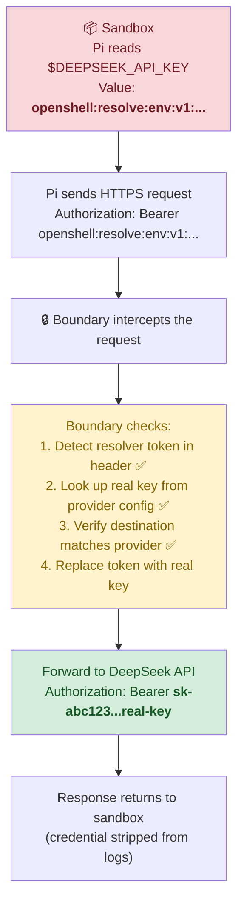

# Credential Security

In this module you will prove that API keys are **never visible** inside the sandbox. The sandbox sees only opaque resolver tokens. Real credentials are injected at the network boundary, outside the agent's reach.

## The Problem

AI agents need API keys to call external services (LLMs, APIs, databases). Traditionally, you pass the key as an environment variable:

```bash
# Traditional approach — DANGEROUS
export DEEPSEEK_API_KEY=sk-abc123...real-key-here
```

This means the agent process can:
- `echo $DEEPSEEK_API_KEY` to print it
- Encode it in a network request to exfiltrate it
- Write it to a file for later retrieval
- Pass it to a subprocess

**OpenShell's approach: credential resolution at the boundary.**

## How Credential Resolution Works



The critical security properties:

1. **Sandbox never sees the real key** — only the resolver token `openshell:resolve:env:v1:...`
2. **Boundary resolves at the network edge** — the real key is injected just before the request leaves the cluster
3. **Endpoint binding** — a resolver token for DeepSeek cannot be used to authenticate to a different service
4. **No exfiltration possible** — even if the agent sends the resolver token to an attacker, it's useless outside the OpenShell boundary

## Step 1 — Enter the Sandbox

```bash
openshell sandbox exec pi-agent-demo -- bash
```

## Step 2 — Print the Environment Variable

```bash
echo $DEEPSEEK_API_KEY
```

Expected output (the exact token varies):

```
openshell:resolve:env:v1:deepseek:api_key:a1b2c3d4e5f6
```

✅ This is a **resolver token**, not the real key. It starts with `openshell:resolve:env:v1:` followed by the provider name and a random identifier.

## Step 3 — Try to Extract the Key

Even programmatic attempts to extract the key fail:

```bash
env | grep -i deepseek
```

Expected:

```
DEEPSEEK_API_KEY=openshell:resolve:env:v1:deepseek:api_key:a1b2c3d4e5f6
```

The resolver token is all that exists in the sandbox's environment. There is no second copy of the real key anywhere inside the container.

## Step 4 — Prove the Resolver Token Works (When Used Correctly)

Make a real API call using the resolver token — the boundary will resolve it:

```bash
curl -s https://api.deepseek.com/models \
  -H "Authorization: Bearer $DEEPSEEK_API_KEY" | head -c 200
```

Expected: a JSON response listing available models (truncated):

```json
{"object":"list","data":[{"id":"deepseek-chat","object":"model"...
```

✅ **The call succeeds** because the boundary intercepted the request, saw the resolver token, replaced it with the real DeepSeek API key, and forwarded the request. The sandbox itself never handled the real key.

## Step 5 — Prove Endpoint Binding

What if the agent tries to use the DeepSeek resolver token to authenticate to a different service?

```bash
curl -s --max-time 5 https://api.openai.com/v1/models \
  -H "Authorization: Bearer $DEEPSEEK_API_KEY" 2>&1
```

Expected: connection timeout (because `api.openai.com` is not in the network policy) or a `credential_endpoint_mismatch` error.

❌ **The boundary rejects this** because the resolver token is bound to `api.deepseek.com`. Even if the network policy allowed `api.openai.com`, the credential would not be resolved for a different host.

## Step 6 — Prove Exfiltration Is Useless

If an attacker somehow extracted the resolver token and tried to use it outside the cluster:

```bash
# This is what the attacker would try (from their machine):
# curl https://api.deepseek.com/models -H "Authorization: Bearer openshell:resolve:env:v1:..."
```

Result: **401 Unauthorized**. The resolver token is meaningless outside the OpenShell boundary. DeepSeek's API doesn't recognize it — it expects a real `sk-` key. The boundary is the only component that can resolve the token, and it only does so inside the cluster.

## Step 7 — Exit the Sandbox

```bash
exit
```

## Credential Lifecycle

The real API key passes through three zones. Only the Gateway zone ever holds the real key.

| Phase | What Happens | Who Sees the Real Key? |
|-------|-------------|----------------------|
| **Install** | Helm stores key in Vault → ESO syncs to K8s Secret | Vault and K8s Secret (encrypted at rest) |
| **Runtime** | Gateway reads K8s Secret, registers provider | Gateway only |
| **API Call** | Sandbox sends resolver token → Boundary swaps for real key → DeepSeek receives real key | Boundary (in-memory, per-request) |

## Key Takeaways

| Property | Traditional | OpenShell |
|----------|------------|-----------|
| Agent sees real key | ✅ Yes | ❌ No — only resolver token |
| Key can be logged | ✅ Yes | ❌ No — token is opaque |
| Key can be exfiltrated | ✅ Yes | ❌ No — token is useless outside boundary |
| Key bound to endpoint | ❌ No | ✅ Yes — credential_endpoint_mismatch |
| Key stored in Vault | Optional | ✅ Yes — via ZTVP Vault + ESO |

## Next Step

You've proven that credentials are invisible inside the sandbox. Next, you'll explore how the ZTVP components work together.

Proceed to: **ZTVP Integration** →
