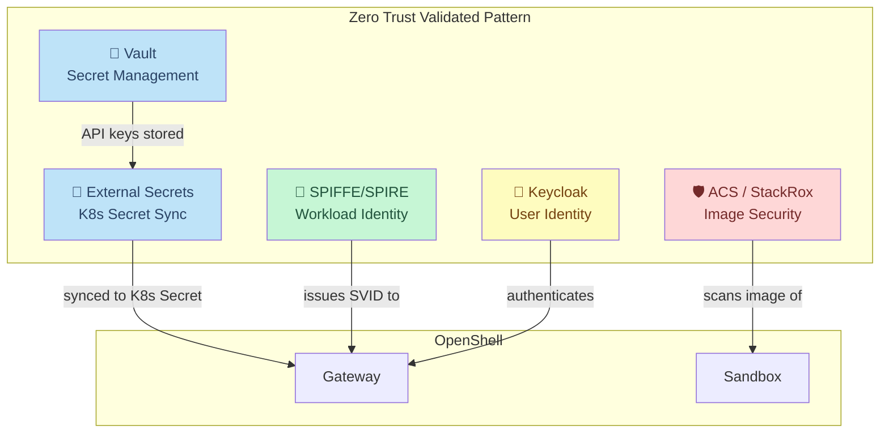
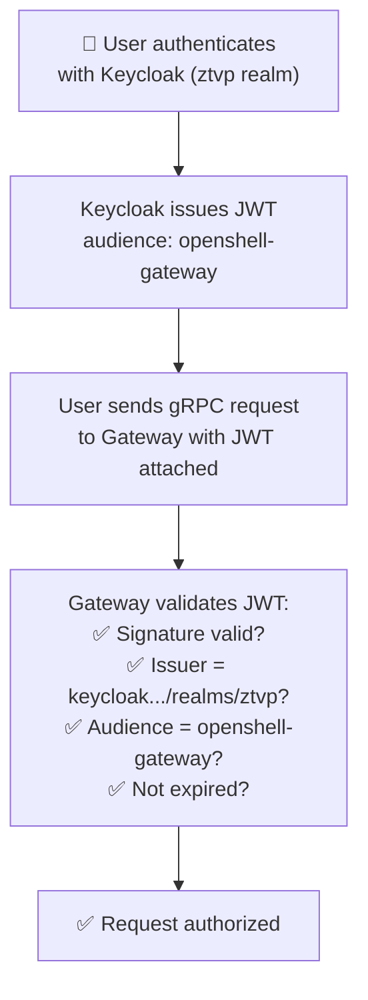

# ZTVP Integration

In this module you will explore how the **Zero Trust Validated Pattern** components work together with OpenShell to form a **defense-in-depth** security architecture. Each component addresses a different attack vector — together, they create multiple layers that an attacker would need to penetrate simultaneously.

> **What is defense-in-depth?** It's a security strategy where multiple independent layers protect the system. If one layer fails, the others still hold. Think of a castle with a moat, a wall, a gate, and armed guards — compromising any one layer doesn't give you full access.

## The Five Pillars

The ZTVP provides five security capabilities. OpenShell plugs into all of them:



**Reading the diagram:** Each ZTVP component connects to OpenShell in a different way:
- **Vault + ESO** → stores and syncs the MAAS API key to the Gateway
- **SPIFFE/SPIRE** → gives the Gateway a cryptographic identity
- **ACS** → scans the sandbox container image for vulnerabilities
- **Keycloak** → authenticates users who access the Gateway

## Pillar 1: Vault — Secret Management

> **What is Vault?** [HashiCorp Vault](https://www.vaultproject.io/) is a secret management system. It stores sensitive data (API keys, passwords, certificates) in encrypted storage with fine-grained access control. Instead of putting secrets in Kubernetes Secrets (which are base64-encoded, not encrypted), you put them in Vault where they're encrypted at rest, access-logged, and rotatable.

The OpenShell Gateway's **Vault credential driver** stores the MAAS API key in Vault automatically when the provider is registered during install.

### Verify Vault Is Running

```bash
oc get pods -n vault -l app.kubernetes.io/name=vault
```

Expected:

```
NAME      READY   STATUS    RESTARTS   AGE
vault-0   1/1     Running   0          ...
```

### Verify the Gateway Stored Credentials in Vault

The Gateway uses Vault as its credential backend. It stores provider credentials at opaque, hashed paths under `secret/openshell/provider-credentials/`:

```bash
VAULT_POD=$(oc get pod -n vault -l app.kubernetes.io/name=vault \
  -o jsonpath='{.items[0].metadata.name}')

oc exec -n vault $VAULT_POD -- vault kv list secret/openshell/provider-credentials/
```

Expected: a list of SHA-1 hashed entries:

```
Keys
----
5545570f04581f16f30b567f8152703f9c2bae8f
a55f6c42779c956cd0f496bed3e3ad23b3deee65
...
```

> **Why hashed names?** The Gateway hashes credential identities before using them as Vault key names. Even a Vault admin can't tell which entry holds which provider's key without Gateway access. This is a defense-in-depth measure — compromising Vault alone doesn't reveal which secrets belong to which service.

You can confirm one of these entries holds the real MAAS key (first 10 characters only):

```bash
HASH=$(oc exec -n vault $VAULT_POD -- vault kv list -format=json \
  secret/openshell/provider-credentials/ | python3 -c "import sys,json; print(json.load(sys.stdin)[0])")

oc exec -n vault $VAULT_POD -- vault kv get -field=value \
  secret/openshell/provider-credentials/$HASH | head -c 10
echo "..."
```

Expected: the first 10 characters of your MAAS key (e.g., `sk-HVLlF0_m...`).

> **How did the key get there?** During `helm install`, the setup job ran `openshell provider create --credential "MAAS_API_KEY=sk-..."`. The Gateway received the key via its gRPC API and its Vault credential driver wrote it to `secret/openshell/provider-credentials/<hash>`. No manual Vault write, no External Secrets Operator, no bridge — the Gateway handles Vault storage directly.

### The Vault Integration Path

| Component | Role |
|-----------|------|
| **Vault credential driver** | Gateway authenticates to Vault via K8s auth (`auth/hub`), stores and retrieves credentials |
| **Vault KV v2** | Encrypted at-rest storage at `secret/openshell/provider-credentials/` |
| **K8s auth** | The Gateway's ServiceAccount token proves its identity to Vault — no static credentials |
| **openshell-admin role** | Vault role that grants read/write to the `secret/openshell/` path |

> **What about ESO?** The ZTVP deploys the External Secrets Operator for other applications that need Vault-to-K8s-Secret syncing. OpenShell does **not** use ESO — its Gateway talks to Vault directly via the credential driver. This is a cleaner architecture: one fewer component in the chain, and the Gateway owns the full credential lifecycle (storage, rotation, deletion).

## Pillar 3: SPIFFE/SPIRE — Workload Identity

> **What is SPIFFE?** [SPIFFE](https://spiffe.io/) (Secure Production Identity Framework for Everyone) is a standard for issuing cryptographic identities to workloads. Instead of saying "this pod is in namespace X, therefore it's trusted," SPIFFE says "this pod has a cryptographically signed certificate (called an SVID) that proves exactly who it is."

> **What is SPIRE?** SPIRE is the reference implementation of SPIFFE. It runs as a DaemonSet (agent on every node) and issues SVIDs (SPIFFE Verifiable Identity Documents) — X.509 certificates that prove a workload's identity.

### Verify the SPIFFE Registration

```bash
oc get clusterspiffeids | grep openshell
```

Expected:

```
openshell-gateway   ...
```

> **What does this mean?** A `ClusterSPIFFEID` resource tells SPIRE: "Issue a SPIFFE identity to pods matching this selector." The `openshell-gateway` entry means SPIRE issues an SVID to the Gateway pod.

### What SPIFFE Provides

| Property | Value |
|----------|-------|
| Identity format | `spiffe://<CLUSTER_DOMAIN>/ns/openshell-system/sa/openshell-ztm-demo` |
| Certificate type | X.509 SVID (a standard TLS certificate with a SPIFFE ID) |
| Rotation | Automatic — SPIRE rotates certificates before they expire |
| Trust domain | The cluster's FQDN (e.g., `apps.ocp.xxxxx.sandboxNNNN.opentlc.com`) |

> **Why does this matter?** In zero trust, you can't assume "same network = trusted." SPIFFE gives each workload a cryptographic passport. The Gateway can prove to Vault, to Keycloak, or to any other service that it is who it claims to be — without shared secrets or static credentials.

## Pillar 4: ACS (StackRox) — Image Security

> **What is ACS?** [Red Hat Advanced Cluster Security](https://www.redhat.com/en/technologies/cloud-computing/openshift/advanced-cluster-security-kubernetes) for Kubernetes (formerly StackRox) continuously scans container images and running deployments for security issues.

ACS scans for:
- **Known CVEs** (Common Vulnerabilities and Exposures) — known bugs in libraries
- **Sensitive data** — embedded secrets, private keys, passwords in the image
- **Misconfigurations** — running as root, writable root filesystem, privilege escalation
- **Compliance violations** — PCI-DSS, HIPAA, NIST standards

### Verify ACS Is Running

```bash
oc get pods -n stackrox -l app=central --no-headers
```

Expected:

```
central-xxxxxxxxx-xxxxx   1/1   Running   0   ...
```

You can also open the ACS Console in your browser:

```
https://central-stackrox.<CLUSTER_DOMAIN>
```

> **Note:** This lab does not configure image-specific scan policies for OpenShell. ACS is deployed by ZTVP and continuously monitors the cluster — scanning deployed images for CVEs, detecting misconfigurations, and enforcing security policies. In a production deployment, you would configure ACS admission control policies to block images with critical CVEs from being deployed.

> **Why does ACS matter in a zero-trust architecture?** Even with network and filesystem enforcement, a compromised container image (e.g., one with a backdoored dependency) could attack from *inside* the sandbox. ACS provides the image-level assurance: it verifies that the sandbox image itself is safe before and after deployment.

## Pillar 5: Keycloak — User Identity

> **What is Keycloak?** [Keycloak](https://www.keycloak.org/) is an open-source identity and access management (IAM) system. It provides SSO (Single Sign-On), OIDC (OpenID Connect), and user federation. In this lab, Keycloak authenticates users who access the OpenShell Gateway.

The ZTVP deploys a `ztvp` realm in Keycloak with pre-configured clients.

### Verify the Keycloak OIDC Client

```bash
KEYCLOAK_URL=https://keycloak.<CLUSTER_DOMAIN>
ADMIN_PASSWORD=$(oc get secret keycloak-admin-user -n keycloak-system -o jsonpath='{.data.password}' | base64 -d)

TOKEN=$(curl -sk "$KEYCLOAK_URL/realms/master/protocol/openid-connect/token" \
  -d "client_id=admin-cli" \
  -d "username=admin" \
  -d "password=$ADMIN_PASSWORD" \
  -d "grant_type=password" | python3 -c "import sys,json; print(json.load(sys.stdin)['access_token'])")

curl -sk "$KEYCLOAK_URL/admin/realms/ztvp/clients" \
  -H "Authorization: Bearer $TOKEN" | python3 -c "
import sys, json
clients = json.load(sys.stdin)
for c in clients:
    if 'openshell' in c.get('clientId',''):
        print(f\"Client: {c['clientId']}\")
        print(f\"Enabled: {c['enabled']}\")
        print(f\"Protocol: {c.get('protocol','')}\")
"
```

Expected:

```
Client: openshell-gateway
Enabled: True
Protocol: openid-connect
```

> **What does this prove?** The `openshell-gateway` OIDC client exists in Keycloak's `ztvp` realm. The Gateway is configured to validate JWT tokens issued by this Keycloak realm. In production, users would log in through Keycloak to get a JWT, and the Gateway would verify it before allowing access.

### Authentication Flow



> **What is a JWT?** A JSON Web Token is a signed, base64-encoded JSON document. Keycloak signs it with its private key. The Gateway verifies the signature with Keycloak's public key. If the signature is valid, the token hasn't been tampered with. JWTs contain claims like "who is this user," "what are they allowed to do," and "when does this token expire."

## Defense in Depth Summary

Each pillar addresses a different attack vector. An attacker would need to defeat **all of them simultaneously** to fully compromise the system:

| Attack Vector | Mitigation | ZTVP Pillar |
|--------|-----------|-------------|
| Stolen MAAS API key | Key in Vault, resolver token in sandbox | **Vault + ESO** |
| Impersonated workload | Cryptographic SPIFFE identity (X.509 SVID) | **SPIRE** |
| Vulnerable container image | Continuous CVE scanning + admission control | **ACS** |
| Unauthorized user access | OIDC JWT validation via Keycloak | **Keycloak** |
| Network exfiltration | Allowlist-only network policy with binary enforcement | **OpenShell** |
| Filesystem escape | Kernel-enforced Landlock LSM restrictions | **OpenShell** |
| Credential leakage | Boundary resolver tokens (never expose real keys) | **OpenShell** |

> **This is zero trust in action.** No single component is sufficient alone. Vault without network policy means keys are safe but data can be exfiltrated. Network policy without Landlock means you can't reach the internet but can modify local binaries. Each layer compensates for the others' blind spots.

## Next Step

You've seen all five pillars of the ZTVP working with OpenShell. Next, you'll explore how **user authentication** works — from Keycloak OIDC to JWT tokens to what the Gateway validates.

Proceed to: **User Authentication** →
