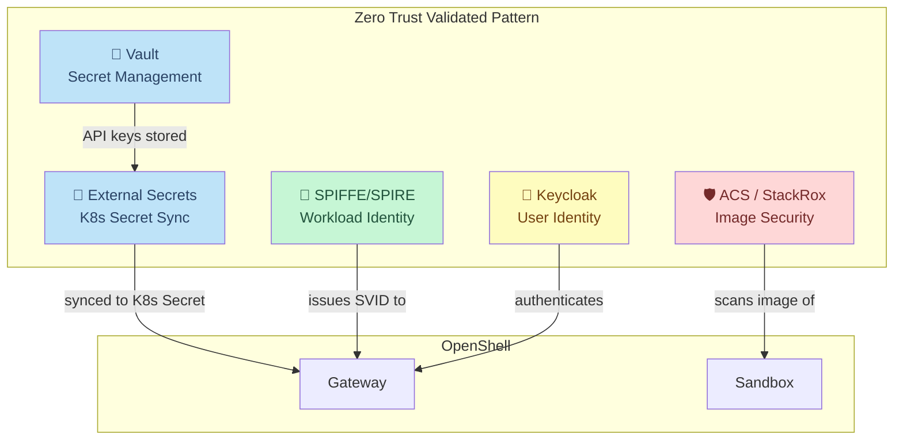
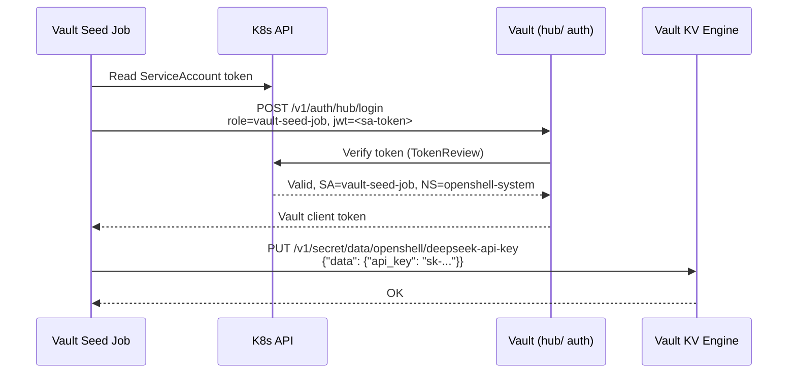
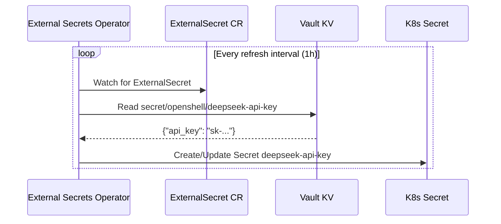
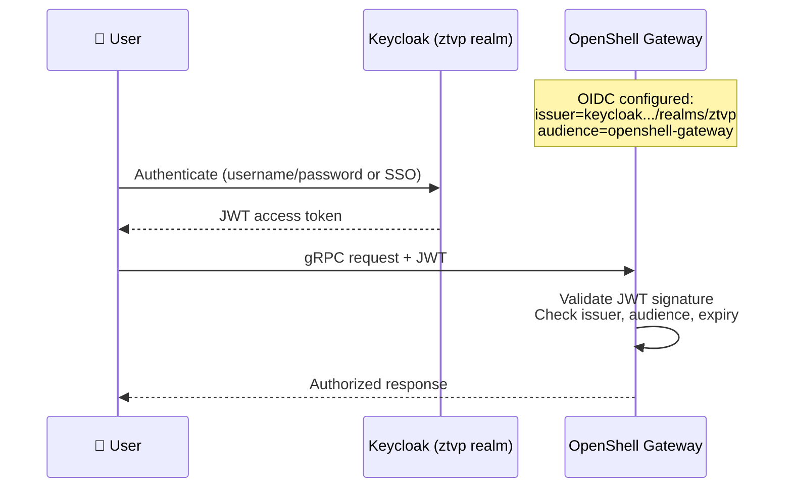

# ZTVP Integration

In this module you will explore how the Zero Trust Validated Pattern components work together with OpenShell to form a defense-in-depth security architecture.

## The Five Pillars

The ZTVP provides five security capabilities that integrate with OpenShell:



## Pillar 1: Vault — Secret Management

Vault stores the DeepSeek API key. The Helm chart's pre-install hook seeds it automatically.

### Verify the Secret in Vault

From the bastion:

```bash
export VAULT_ADDR=https://vault.<CLUSTER_DOMAIN>
export VAULT_SKIP_VERIFY=true

VAULT_TOKEN=$(oc get secret vault-init -n vault -o jsonpath='{.data.root_token}' | base64 -d)
export VAULT_TOKEN

vault kv get secret/openshell/deepseek-api-key
```

**Why:** This confirms the Helm chart's pre-install hook successfully stored the API key in Vault. The `vault kv get` command reads from Vault's KV v2 engine.

Expected output (key is redacted):

```
====== Data ======
Key           Value
---           -----
api_key       sk-****...
```

### The Vault Path

| Path | Purpose |
|------|---------|
| `secret/data/openshell/deepseek-api-key` | DeepSeek API key for the sandbox |

The Vault auth method is Kubernetes auth mounted at path `hub/`. The vault-seed Job authenticates using its ServiceAccount token.

### Vault Architecture Diagram



## Pillar 2: External Secrets Operator — Secret Sync

ESO watches `ExternalSecret` resources and syncs them from Vault to Kubernetes Secrets.

### Verify the ExternalSecret

```bash
oc get externalsecrets -n openshell-system
```

Expected:

```
NAME                  STORE          REFRESH   STATUS
deepseek-api-key      vault-backend  1h        SecretSynced
```

### Verify the K8s Secret

```bash
oc get secret deepseek-api-key -n openshell-system -o jsonpath='{.data.api_key}' | base64 -d | head -c 10
echo "..."
```

**Why:** This shows that ESO has successfully synced the key from Vault into a Kubernetes Secret. We only print the first 10 characters to confirm it's the right key without exposing the full value.

### How ESO Syncs



## Pillar 3: SPIFFE/SPIRE — Workload Identity

SPIFFE (Secure Production Identity Framework for Everyone) provides cryptographic identities to workloads. Each OpenShell component gets a **SVID** (SPIFFE Verifiable Identity Document) — an X.509 certificate proving its identity without shared secrets.

### Verify the SPIFFE Registration

```bash
oc get clusterspiffeids -l app=openshell
```

**Why:** `ClusterSPIFFEID` resources tell SPIRE which SPIFFE IDs to issue to which pods.

### What SPIFFE Provides

| Property | Value |
|----------|-------|
| Identity format | `spiffe://cluster.local/ns/openshell-system/sa/openshell-gateway` |
| Certificate type | X.509 SVID |
| Rotation | Automatic (SPIRE agent handles renewal) |
| Trust domain | `cluster.local` |

SPIFFE ensures that the Gateway can prove its identity to other services without static credentials. This is foundational to zero trust: **identity is cryptographic, not network-based**.

## Pillar 4: ACS (StackRox) — Image Security

Red Hat Advanced Cluster Security for Kubernetes (ACS) continuously scans container images for:

- Known CVEs (Common Vulnerabilities and Exposures)
- Sensitive data (embedded secrets, private keys)
- Misconfigurations (running as root, writable filesystem)
- Compliance violations (PCI-DSS, HIPAA, NIST)

### Check the Sandbox Image Scan

Open ACS in your browser:

```
https://central-stackrox.<CLUSTER_DOMAIN>
```

Navigate to: **Vulnerability Management → Images** and search for `openshell`.

Alternatively, from the bastion:

```bash
oc get image-vulnerabilities -n openshell-system 2>/dev/null || echo "Check ACS Console for scan results"
```

### What ACS Enforces

| Check | OpenShell Sandbox |
|-------|-------------------|
| Critical CVEs | Scanned on every pull |
| Run as root | Denied by policy |
| Writable root filesystem | Controlled by Landlock |
| Network exposure | Limited by OpenShell policy |

## Pillar 5: Keycloak — User Identity

Keycloak provides SSO and OIDC for user authentication. The ZTVP deploys a `ztvp` realm with pre-configured clients.

### Verify the Keycloak OIDC Client

```bash
KEYCLOAK_URL=https://keycloak.<CLUSTER_DOMAIN>
ADMIN_PASSWORD=$(oc get secret keycloak-initial-admin -n keycloak-system -o jsonpath='{.data.password}' | base64 -d)

TOKEN=$(curl -sk "$KEYCLOAK_URL/realms/master/protocol/openid-connect/token" \
  -d "client_id=admin-cli" \
  -d "username=admin" \
  -d "password=$ADMIN_PASSWORD" \
  -d "grant_type=password" | python3 -c "import sys,json; print(json.load(sys.stdin)['access_token'])")

curl -sk "$KEYCLOAK_URL/admin/realms/ztvp/clients" \
  -H "Authorization: Bearer $TOKEN" | python3 -c "
import sys, json
clients = json.load(sys.stdin)
for c in clients:
    if 'openshell' in c.get('clientId',''):
        print(f\"Client: {c['clientId']}\")
        print(f\"Enabled: {c['enabled']}\")
        print(f\"Protocol: {c.get('protocol','')}\")
"
```

Expected:

```
Client: openshell-gateway
Enabled: True
Protocol: openid-connect
```

**Why:** This confirms the `openshell-gateway` OIDC client exists in Keycloak's `ztvp` realm. The Gateway is configured to validate JWT tokens issued by this Keycloak realm.

### Authentication Flow



## Defense in Depth Summary

Each ZTVP pillar addresses a different attack vector:

| Attack | Mitigation | ZTVP Pillar |
|--------|-----------|-------------|
| Stolen API key | Key in Vault, resolver token in sandbox | Vault + ESO |
| Impersonated workload | Cryptographic SPIFFE identity | SPIRE |
| Vulnerable container image | Continuous CVE scanning | ACS |
| Unauthorized user access | OIDC JWT validation | Keycloak |
| Network exfiltration | Allowlist-only network policy | OpenShell |
| Filesystem escape | Landlock LSM restrictions | OpenShell |
| Credential leakage | Boundary resolver tokens | OpenShell |

## Next Step

You've seen all five pillars of the ZTVP working with OpenShell. Next, you'll learn how to dynamically update the zero-trust policy.

Proceed to: **Dynamic Policy** →
