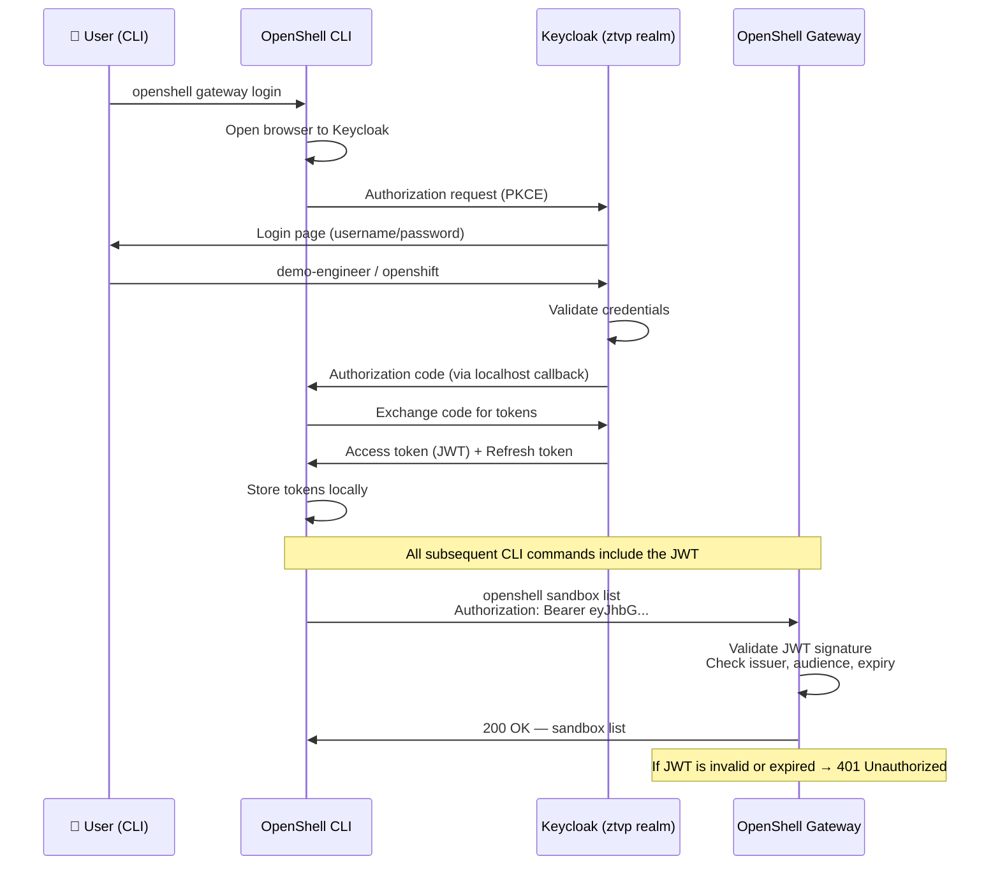
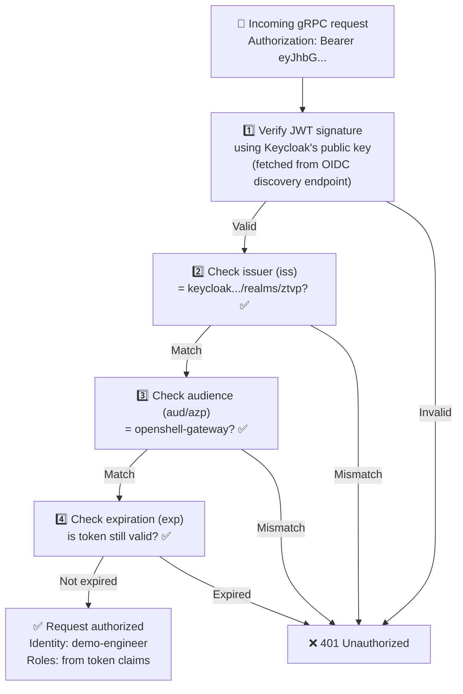
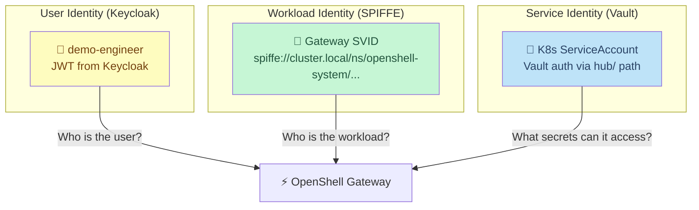

# User Authentication

In the previous modules you connected to the Gateway without logging in. The Gateway allowed it because it's configured with `allowUnauthenticatedUsers: true` for this lab. But in a real deployment, **every user must authenticate** before managing sandboxes.

This module walks through the full OIDC authentication flow — from creating a user in Keycloak to obtaining a JWT and understanding what the Gateway validates.

> **Why does user auth matter for AI agents?** Without user authentication, anyone who can reach the Gateway URL can create sandboxes, run code, and access LLM providers. In a multi-tenant environment, you need to know *who* is creating sandboxes, *what* they're allowed to do, and *when* they did it — that requires authenticated identity.

## The Current State: Unauthenticated

Right now you can manage sandboxes without any login credentials. Verify by listing sandboxes — no token required:

```bash
openshell sandbox list
```

Expected:

```
NAME           CREATED              PHASE
pi-agent-demo  2026-xx-xx xx:xx:xx  Ready
```

This works because the Gateway is configured with `allowUnauthenticatedUsers: true`. Under the hood, the Gateway assigns you a **default identity**:

| Property | Value | Meaning |
|----------|-------|---------|
| **Subject** | `unauthenticated-local-dev` | A placeholder — the Gateway doesn't know who you are |
| **Provider** | `local_dev` | The identity came from the Gateway's built-in fallback, not from Keycloak |
| **Roles** | `openshell-user, openshell-admin` | Full admin access by default |
| **Scopes** | `openshell:all` | Every operation is permitted |

> **This is fine for a lab, but dangerous in production.** Anyone who knows the Gateway URL gets full admin rights. There is no audit trail — every action is logged as "someone did something" rather than "demo-engineer created sandbox X at 14:32 UTC".

## The Authentication Architecture

Here is the complete OIDC flow that production deployments use:



> **What is PKCE?** PKCE (Proof Key for Code Exchange, pronounced "pixie") is a security extension to the OAuth2 authorization code flow. It prevents authorization code interception attacks by requiring the CLI to prove it initiated the login request. The CLI generates a random `code_verifier`, hashes it to create a `code_challenge`, sends the challenge with the auth request, and later proves knowledge of the verifier when exchanging the code for tokens.

## Step 1 — Create a Demo User in Keycloak

The ZTVP realm comes with service users (like `acs-admin`), but no regular human user. Let's create one:

```bash
KEYCLOAK_URL=https://keycloak.<CLUSTER_DOMAIN>
ADMIN_PASSWORD=$(oc get secret keycloak-admin-user -n keycloak-system -o jsonpath='{.data.password}' | base64 -d)
```

> **Where does the admin password come from?** Keycloak stores its initial admin credentials in a Kubernetes Secret called `keycloak-admin-user` in the `keycloak-system` namespace. We're reading it, base64-decoding it, and using it to call the Keycloak Admin REST API.

Get an admin token:

```bash
ADMIN_TOKEN=$(curl -sk "$KEYCLOAK_URL/realms/master/protocol/openid-connect/token" \
  -d "client_id=admin-cli" \
  -d "username=admin" \
  -d "password=$ADMIN_PASSWORD" \
  -d "grant_type=password" | python3 -c "import sys,json; print(json.load(sys.stdin)['access_token'])")
```

> **Breaking this down:**
> - `realms/master` — the admin user lives in the `master` realm (Keycloak's built-in admin realm)
> - `client_id=admin-cli` — Keycloak's built-in admin CLI client
> - `grant_type=password` — ROPC (Resource Owner Password Credentials) flow. We send username+password directly and get a token back. This is acceptable for admin automation but **not recommended for end users** (use the browser flow instead).

Create the user:

```bash
curl -sk -w "\nHTTP %{http_code}\n" \
  "$KEYCLOAK_URL/admin/realms/ztvp/users" \
  -H "Authorization: Bearer $ADMIN_TOKEN" \
  -H "Content-Type: application/json" \
  -d '{
    "username": "demo-engineer",
    "enabled": true,
    "email": "engineer@example.com",
    "firstName": "Demo",
    "lastName": "Engineer",
    "emailVerified": true,
    "credentials": [{"type": "password", "value": "openshift", "temporary": false}]
  }'
```

Expected:

```
HTTP 201
```

> **HTTP 201 = Created.** The user `demo-engineer` now exists in the `ztvp` realm with password `openshift`. If you get HTTP 409, the user already exists from a previous run — that's fine.

## Step 2 — Obtain a JWT Token

In production, users would click through a browser login page. On this bastion (no browser), we'll use the **ROPC flow** to demonstrate the concept:

```bash
JWT_RESPONSE=$(curl -sk "$KEYCLOAK_URL/realms/ztvp/protocol/openid-connect/token" \
  -d "client_id=openshell-gateway" \
  -d "username=demo-engineer" \
  -d "password=openshift" \
  -d "grant_type=password")

echo "$JWT_RESPONSE" | python3 -c "import sys,json; print(json.dumps(json.load(sys.stdin), indent=2))" | head -10
```

Expected:

```json
{
  "access_token": "eyJhbGciOiJSUzI1NiIsInR5cCI6...",
  "expires_in": 300,
  "refresh_expires_in": 1800,
  "refresh_token": "eyJhbGciOiJIUzUxMiIsInR5cCI6...",
  "token_type": "Bearer",
  "not-before-policy": 0,
  "session_state": "...",
  "scope": "profile email openid"
}
```

> **What's in this response?**
> - **access_token** — the JWT that proves who you are. This is what gets sent to the Gateway.
> - **expires_in: 300** — the access token expires in 5 minutes. Short-lived tokens limit damage if stolen.
> - **refresh_token** — used to get a new access token without re-entering credentials. Lasts 30 minutes.
> - **scope** — the granted scopes: `profile email openid`.
> - **token_type: Bearer** — tells the client to send it as `Authorization: Bearer <token>`.

## Step 3 — Decode the JWT

A JWT has three parts separated by dots: `header.payload.signature`. Let's decode the payload to see the claims:

```bash
ACCESS_TOKEN=$(echo "$JWT_RESPONSE" | python3 -c "import sys,json; print(json.load(sys.stdin)['access_token'])")

echo "$ACCESS_TOKEN" | python3 -c "
import sys, base64, json
token = sys.stdin.read().strip()
payload = token.split('.')[1]
payload += '=' * (4 - len(payload) % 4)
claims = json.loads(base64.b64decode(payload))
print(json.dumps(claims, indent=2))
"
```

Expected (key fields):

```json
{
  "sub": "33c7874c-112b-4ebb-acd6-d172e745bf42",
  "preferred_username": "demo-engineer",
  "email": "engineer@example.com",
  "name": "Demo Engineer",
  "iss": "https://keycloak.<CLUSTER_DOMAIN>/realms/ztvp",
  "azp": "openshell-gateway",
  "scope": "profile email openid",
  "exp": 1730446800
}
```

> **Reading the JWT claims:**
>
> | Claim | Meaning | Gateway checks this? |
> |-------|---------|---------------------|
> | `sub` | Subject — a unique UUID for this user | ✅ Used for audit logs and access control |
> | `preferred_username` | Human-readable username | ✅ Displayed in `whoami` |
> | `iss` (issuer) | Who issued the token — must match the Gateway's OIDC config | ✅ **Must match** `https://keycloak.<CLUSTER_DOMAIN>/realms/ztvp` |
> | `azp` (authorized party) | Which client requested the token | ✅ **Must be** `openshell-gateway` |
> | `exp` (expiration) | Unix timestamp when the token expires | ✅ Rejects expired tokens |
> | `scope` | What the token grants access to | ✅ Maps to OpenShell permissions |
>
> **If any check fails, the Gateway returns 401 Unauthorized.** A token from a different Keycloak realm, a different client, or an expired token is rejected.

## Step 4 — Understand the Gateway Validation

The Gateway is configured with these OIDC settings (from the Helm chart values):

```yaml
auth:
  allowUnauthenticatedUsers: true    # ← For this lab only!
oidc:
  issuer: "https://keycloak.<CLUSTER_DOMAIN>/realms/ztvp"
  audience: "openshell-gateway"
```

When the Gateway receives a request with a JWT:



> **How does the Gateway know Keycloak's public key?** OIDC defines a discovery endpoint at `{issuer}/.well-known/openid-configuration`. The Gateway fetches this on startup to learn the token signing keys, supported algorithms, and token endpoint URLs. This means the Gateway never stores Keycloak's private key — it only needs the public key to verify signatures.

## Step 5 — Register Gateway with OIDC (Production Flow)

In a production environment (with a browser), you would register the Gateway for OIDC login:

```bash
openshell gateway add "$OPENSHELL_GATEWAY_ENDPOINT" \
  --name ztm-demo \
  --oidc-issuer "https://keycloak.<CLUSTER_DOMAIN>/realms/ztvp" \
  --oidc-client-id "openshell-gateway" \
  --oidc-audience "openshell-gateway" \
  --gateway-insecure
```

This registers the Gateway and opens a browser to the Keycloak login page:

```
✓ Gateway 'ztm-demo' added and set as active
  Endpoint: https://openshell-ztm-demo-openshell-system.<CLUSTER_DOMAIN>
  Auth: oidc

  Opening browser for OIDC authentication...
  Open this URL in your browser:
    https://keycloak.<CLUSTER_DOMAIN>/realms/ztvp/protocol/openid-connect/auth?
      response_type=code&
      client_id=openshell-gateway&
      code_challenge=ck7ZZ-JxPY...&
      code_challenge_method=S256&
      redirect_uri=http://127.0.0.1:40315/callback&
      scope=openid&
      audience=openshell-gateway
```

> **What happens in this URL?**
> - `response_type=code` — Authorization Code flow (not implicit — more secure)
> - `code_challenge` + `code_challenge_method=S256` — PKCE protection
> - `redirect_uri=http://127.0.0.1:40315/callback` — the CLI starts a temporary local HTTP server to receive the callback
> - `scope=openid` — request an OpenID Connect token (includes identity claims)

After logging in through the browser, the CLI stores the token locally. All subsequent commands (`sandbox list`, `sandbox exec`, etc.) automatically include the JWT.

> **On the bastion (headless),** the browser can't open. In a real deployment, engineers would run the OpenShell CLI on their laptops where a browser is available. The bastion uses `allowUnauthenticatedUsers: true` as a convenience.

## Step 6 — Authenticated vs Unauthenticated

After completing `openshell gateway login`, the Gateway would identify you by the JWT claims rather than the fallback identity. Compare:

| Property | Unauthenticated | Authenticated |
|----------|----------------|---------------|
| **Subject** | `unauthenticated-local-dev` | `demo-engineer` |
| **Provider** | `local_dev` | `oidc` (Keycloak) |
| **Roles** | `openshell-user, openshell-admin` (everything!) | `openshell-user` (least privilege) |
| **Scopes** | `openshell:all` | `openid, profile, email` |
| **Audit trail** | "Someone did something" | "demo-engineer created sandbox X at 14:32 UTC" |
| **Access control** | None — full admin | Role-based — can use sandboxes but not manage the gateway |

> **Key difference:** Authenticated users get **least-privilege roles**. The admin role is only assigned to specific users, not given away by default. Every action is attributed to a named identity for audit purposes.

## Enforcing Authentication (Production)

To require authentication in production, change the Helm values:

```yaml
openshell:
  server:
    auth:
      allowUnauthenticatedUsers: false   # ← Enforce auth
```

With this setting, any CLI command without a valid JWT returns:

```
Error: 401 Unauthorized — authentication required.
Run `openshell gateway login` to authenticate.
```

## Key Takeaways

| Concept | Detail |
|---------|--------|
| **Protocol** | OpenID Connect (OIDC) — industry standard, built on OAuth 2.0 |
| **Identity provider** | Keycloak (ZTVP's `ztvp` realm) |
| **Client** | `openshell-gateway` (public client, PKCE-protected) |
| **Token type** | JWT (JSON Web Token) — signed by Keycloak, verified by Gateway |
| **Token lifetime** | 5 minutes (access), 30 minutes (refresh) |
| **CLI flow** | `openshell gateway login` → browser → Keycloak → JWT stored locally |
| **Validation** | Gateway checks signature, issuer, audience, and expiration |
| **Audit** | Every CLI action is logged with the authenticated user's identity |

## The Full Zero Trust Identity Stack



> **Three layers of identity, zero assumptions.** The user proves who they are (Keycloak JWT). The workload proves what it is (SPIFFE SVID). The service proves what it can access (Vault K8s auth). No layer trusts the others — each independently verifies.

## Next Step

You've seen the complete authentication picture — from user identity (Keycloak) to workload identity (SPIFFE) to service identity (Vault). Next, you'll dynamically update the zero-trust policy live.

Proceed to: **Dynamic Policy** →
