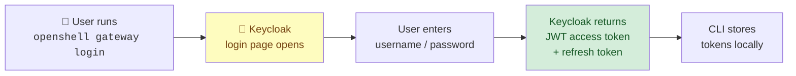
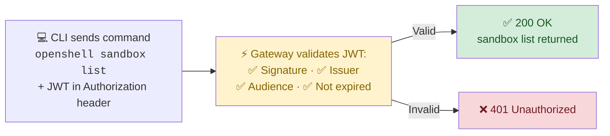
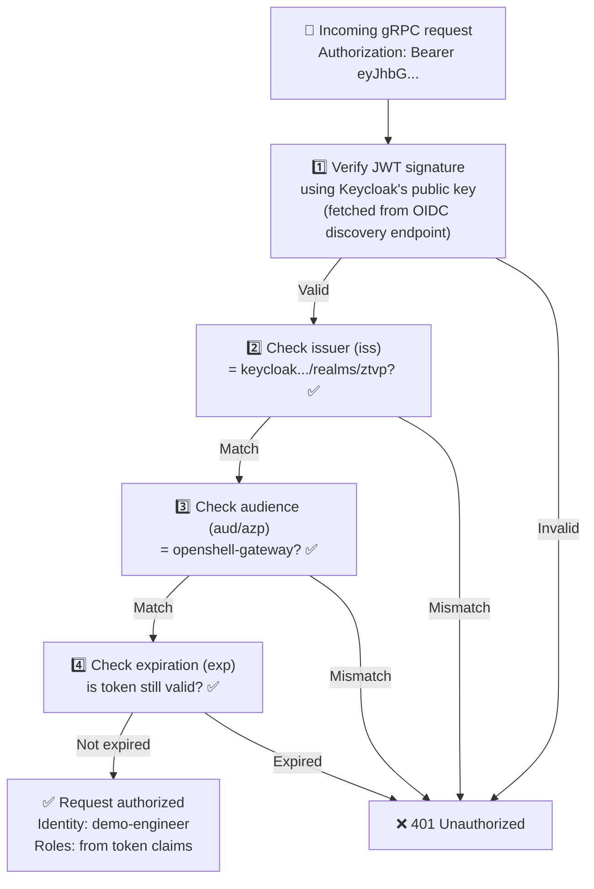
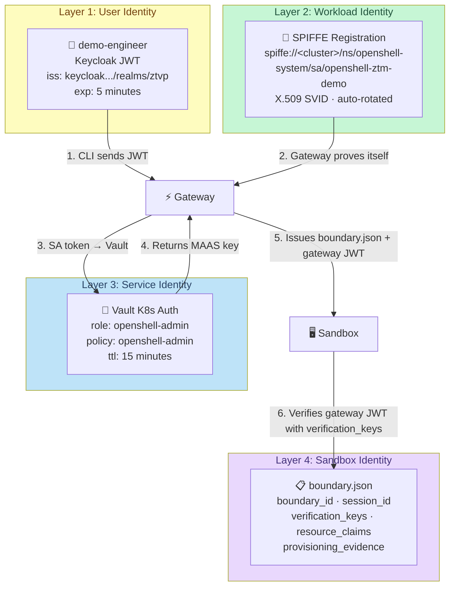

# Agent Identity and Authentication

In the previous modules you connected to the Gateway without logging in. The Gateway allowed it because it's configured with `allowUnauthenticatedUsers: true` for this lab. But in a real deployment, **every participant in the system must prove its identity** — not just users, but workloads, services, and sandboxes.

This module walks through **all four identity layers** in the OpenShell zero-trust architecture:

| Layer | Question it answers | Technology | Verified hands-on? |
|-------|-------------------|------------|-------------------|
| **User Identity** | Who is the human? | Keycloak OIDC / JWT | Yes — Steps 1-8 |
| **Sandbox Identity** | What is this agent's cryptographic identity? | boundary.json + pod identity | Yes — Step 9 |
| **Workload Identity** | Is this workload who it claims to be? | SPIFFE/SPIRE registration | Yes — Step 10 |
| **Service Identity** | What secrets can this service access? | Vault Kubernetes auth | Yes — Step 11 |

> **Why does this matter?** In a zero-trust architecture, no single identity layer is sufficient. A valid user JWT doesn't prove the Gateway itself hasn't been replaced by an attacker. A valid SPIFFE ID doesn't prove the user is authorized. Each layer independently verifies a different trust boundary — together, they eliminate entire classes of impersonation and privilege-escalation attacks.

---

## Part 1: User Identity (Keycloak OIDC)

### The Current State: Unauthenticated

First, confirm your current identity. The `openshell whoami` command asks the Gateway "who am I?":

```bash
openshell whoami
```

Expected:

```
Current User

  Subject: unauthenticated-local-dev
  Name: Unauthenticated Local Dev
  Provider: local_dev
  Roles: openshell-user, openshell-admin
  Scopes: openshell:all
```

> **This is fine for a lab, but dangerous in production.** The Gateway doesn't know who you are, so it gives you a placeholder identity (`unauthenticated-local-dev`) with **full admin rights**. There is no audit trail — every action is logged as "someone did something" rather than "demo-engineer created sandbox X at 14:32 UTC."

### The Authentication Architecture

The OIDC login flow has two phases: **getting a token** and **using it**.

**Phase 1 — Login (one-time)**



**Phase 2 — Every subsequent command**



**The key idea:** You log in once, the CLI stores the JWT locally, and every subsequent command includes it automatically. The Gateway never trusts the caller by default — it validates the token on every request.

> **What is PKCE?** PKCE (Proof Key for Code Exchange, pronounced "pixie") is a security extension to the OAuth2 authorization code flow. It prevents authorization code interception attacks by requiring the CLI to prove it initiated the login request. The CLI generates a random `code_verifier`, hashes it to create a `code_challenge`, sends the challenge with the auth request, and later proves knowledge of the verifier when exchanging the code for tokens.

### Step 1 — Create a Demo User in Keycloak

The ZTVP realm comes with service users (like `acs-admin`), but no regular human user. Let's create one:

```bash
KEYCLOAK_URL=https://keycloak.<CLUSTER_DOMAIN>
ADMIN_PASSWORD=$(oc get secret keycloak-admin-user -n keycloak-system -o jsonpath='{.data.password}' | base64 -d)
```

> **Where does the admin password come from?** Keycloak stores its initial admin credentials in a Kubernetes Secret called `keycloak-admin-user` in the `keycloak-system` namespace. We're reading it, base64-decoding it, and using it to call the Keycloak Admin REST API.

Get an admin token:

```bash
ADMIN_TOKEN=$(curl -sk "$KEYCLOAK_URL/realms/master/protocol/openid-connect/token" \
  -d "client_id=admin-cli" \
  -d "username=admin" \
  -d "password=$ADMIN_PASSWORD" \
  -d "grant_type=password" | python3 -c "import sys,json; print(json.load(sys.stdin)['access_token'])")
```

> **Breaking this down:**
> - `realms/master` — the admin user lives in the `master` realm (Keycloak's built-in admin realm)
> - `client_id=admin-cli` — Keycloak's built-in admin CLI client
> - `grant_type=password` — ROPC (Resource Owner Password Credentials) flow. We send username+password directly and get a token back. This is acceptable for admin automation but **not recommended for end users** (use the browser flow instead).

Create the user:

```bash
curl -sk -w "\nHTTP %{http_code}\n" \
  "$KEYCLOAK_URL/admin/realms/ztvp/users" \
  -H "Authorization: Bearer $ADMIN_TOKEN" \
  -H "Content-Type: application/json" \
  -d '{
    "username": "demo-engineer",
    "enabled": true,
    "email": "engineer@example.com",
    "firstName": "Demo",
    "lastName": "Engineer",
    "emailVerified": true,
    "credentials": [{"type": "password", "value": "openshift", "temporary": false}]
  }'
```

Expected:

```
HTTP 201
```

> **HTTP 201 = Created.** The user `demo-engineer` now exists in the `ztvp` realm with password `openshift`. If you get HTTP 409, the user already exists from a previous run — that's fine.

### Step 2 — Obtain a JWT Token

In production, users would click through a browser login page. On this bastion (no browser), we'll use the **ROPC flow** to demonstrate the concept:

```bash
JWT_RESPONSE=$(curl -sk "$KEYCLOAK_URL/realms/ztvp/protocol/openid-connect/token" \
  -d "client_id=openshell-gateway" \
  -d "username=demo-engineer" \
  -d "password=openshift" \
  -d "grant_type=password")

echo "$JWT_RESPONSE" | python3 -c "import sys,json; print(json.dumps(json.load(sys.stdin), indent=2))" | head -10
```

Expected:

```json
{
  "access_token": "eyJhbGciOiJSUzI1NiIsInR5cCI6...",
  "expires_in": 300,
  "refresh_expires_in": 1800,
  "refresh_token": "eyJhbGciOiJIUzUxMiIsInR5cCI6...",
  "token_type": "Bearer",
  "not-before-policy": 0,
  "session_state": "...",
  "scope": "profile email openid"
}
```

> **What's in this response?**
> - **access_token** — the JWT that proves who you are. This is what gets sent to the Gateway.
> - **expires_in: 300** — the access token expires in 5 minutes. Short-lived tokens limit damage if stolen.
> - **refresh_token** — used to get a new access token without re-entering credentials. Lasts 30 minutes.
> - **scope** — the granted scopes: `profile email openid`.
> - **token_type: Bearer** — tells the client to send it as `Authorization: Bearer <token>`.

### Step 3 — Decode the JWT

A JWT has three parts separated by dots: `header.payload.signature`. Let's decode the payload to see the claims:

```bash
ACCESS_TOKEN=$(echo "$JWT_RESPONSE" | python3 -c "import sys,json; print(json.load(sys.stdin)['access_token'])")

echo "$ACCESS_TOKEN" | python3 -c "
import sys, base64, json
token = sys.stdin.read().strip()
payload = token.split('.')[1]
payload += '=' * (4 - len(payload) % 4)
claims = json.loads(base64.b64decode(payload))
print(json.dumps(claims, indent=2))
"
```

Expected (key fields):

```json
{
  "sub": "33c7874c-112b-4ebb-acd6-d172e745bf42",
  "preferred_username": "demo-engineer",
  "email": "engineer@example.com",
  "name": "Demo Engineer",
  "iss": "https://keycloak.<CLUSTER_DOMAIN>/realms/ztvp",
  "azp": "openshell-gateway",
  "aud": "openshell-gateway",
  "scope": "profile email openid",
  "exp": 1730446800
}
```

> **Reading the JWT claims:**
>
> | Claim | Meaning | Gateway checks this? |
> |-------|---------|---------------------|
> | `sub` | Subject — a unique UUID for this user | ✅ Used for audit logs and access control |
> | `preferred_username` | Human-readable username | ✅ Displayed in `whoami` |
> | `iss` (issuer) | Who issued the token — must match the Gateway's OIDC config | ✅ **Must match** `https://keycloak.<CLUSTER_DOMAIN>/realms/ztvp` |
> | `aud` (audience) | Who the token is intended for | ✅ **Must include** `openshell-gateway` |
> | `azp` (authorized party) | Which client requested the token | ✅ **Must be** `openshell-gateway` |
> | `exp` (expiration) | Unix timestamp when the token expires | ✅ Rejects expired tokens |
> | `scope` | What the token grants access to | ✅ Maps to OpenShell permissions |
>
> **If any check fails, the Gateway returns 401 Unauthorized.** A token from a different Keycloak realm, a different client, or an expired token is rejected.

### Step 4 — Understand the Gateway Validation

The Gateway is configured with these OIDC settings (from the Helm chart values):

```yaml
auth:
  allowUnauthenticatedUsers: true    # ← For this lab only!
oidc:
  issuer: "https://keycloak.<CLUSTER_DOMAIN>/realms/ztvp"
  audience: "openshell-gateway"
```

When the Gateway receives a request with a JWT:



> **How does the Gateway know Keycloak's public key?** OIDC defines a discovery endpoint at `{issuer}/.well-known/openid-configuration`. The Gateway fetches this on startup to learn the token signing keys, supported algorithms, and token endpoint URLs. This means the Gateway never stores Keycloak's private key — it only needs the public key to verify signatures.

### Step 5 — Prepare Keycloak for OIDC Login

Before the CLI can log in via OIDC, the Keycloak client needs two configurations that the Helm chart's setup job does not create automatically.

**5a. Add an audience mapper** so the JWT includes the `aud` claim (the Gateway rejects tokens without it):

```bash
# Find the openshell-gateway client UUID
CLIENT_UUID=$(curl -sk "$KEYCLOAK_URL/admin/realms/ztvp/clients" \
  -H "Authorization: Bearer $ADMIN_TOKEN" | python3 -c "
import sys, json
for c in json.load(sys.stdin):
    if c.get('clientId') == 'openshell-gateway':
        print(c['id']); break
")
echo "Client UUID: $CLIENT_UUID"

# Add the audience mapper
curl -sk -w "\nHTTP %{http_code}\n" \
  "$KEYCLOAK_URL/admin/realms/ztvp/clients/$CLIENT_UUID/protocol-mappers/models" \
  -H "Authorization: Bearer $ADMIN_TOKEN" \
  -H "Content-Type: application/json" \
  -d '{
    "name": "openshell-gateway-audience",
    "protocol": "openid-connect",
    "protocolMapper": "oidc-audience-mapper",
    "consentRequired": false,
    "config": {
      "included.client.audience": "openshell-gateway",
      "id.token.claim": "true",
      "access.token.claim": "true",
      "included.custom.audience": "openshell-gateway"
    }
  }'
```

Expected: `HTTP 201` (or `HTTP 409` if the mapper already exists).

> **Why is this needed?** The Gateway's OIDC config requires `audience: "openshell-gateway"`. By default, Keycloak does not include an `aud` claim in access tokens. The audience mapper tells Keycloak: "When issuing tokens for this client, include `openshell-gateway` in the `aud` claim." Without it, the Gateway rejects the token with "Missing required claim: aud".

**5b. Update the client's redirect URIs** so the CLI's local callback listener is allowed:

```bash
curl -sk -w "\nHTTP %{http_code}\n" -X PUT \
  "$KEYCLOAK_URL/admin/realms/ztvp/clients/$CLIENT_UUID" \
  -H "Authorization: Bearer $ADMIN_TOKEN" \
  -H "Content-Type: application/json" \
  -d '{
    "clientId": "openshell-gateway",
    "redirectUris": ["http://localhost:*/*", "http://127.0.0.1:*/*"],
    "webOrigins": ["+"],
    "publicClient": true,
    "directAccessGrantsEnabled": true,
    "standardFlowEnabled": true,
    "rootUrl": ""
  }'
```

Expected: `HTTP 204`

> **What are these redirect URIs?** When `openshell gateway login` runs, it starts a temporary HTTP server on a random local port (e.g., `http://127.0.0.1:43599/callback`). After you log in at Keycloak, Keycloak redirects the browser back to this URL with the authorization code. The `http://127.0.0.1:*/*` pattern tells Keycloak: "Allow redirects to any port on localhost." Setting `rootUrl` to empty prevents Keycloak from resolving relative redirect URIs against a stale base URL.

**5c. Verify the Gateway's OIDC issuer** points to this cluster's Keycloak:

```bash
oc get configmap openshell-ztm-demo-config -n openshell-system \
  -o jsonpath='{.data.gateway\.toml}' | grep -A3 'oidc'
```

The `issuer` field must match `https://keycloak.<CLUSTER_DOMAIN>/realms/ztvp`. If it points to a different cluster, update the ConfigMap:

```bash
CURRENT_CONFIG=$(oc get configmap openshell-ztm-demo-config -n openshell-system \
  -o jsonpath='{.data.gateway\.toml}')

# Replace the issuer (adjust the old URL if different)
FIXED_CONFIG=$(echo "$CURRENT_CONFIG" | \
  sed "s|issuer = \"https://keycloak\.[^\"]*\"|issuer = \"https://keycloak.<CLUSTER_DOMAIN>/realms/ztvp\"|")

oc create configmap openshell-ztm-demo-config -n openshell-system \
  --from-literal="gateway.toml=$FIXED_CONFIG" --dry-run=client -o yaml | oc apply -f -

# Restart the gateway to pick up the new config
oc delete pod openshell-ztm-demo-0 -n openshell-system
oc wait --for=condition=Ready pod/openshell-ztm-demo-0 -n openshell-system --timeout=60s
```

> **Why might this be wrong?** The Helm chart's setup job sets the OIDC issuer based on the cluster domain at install time. If the chart was built for a different environment, the issuer may point to the wrong Keycloak instance. The Gateway fetches Keycloak's public key from this URL, so a mismatch means "unknown signing key" errors.

### Step 6 — Register an OIDC Gateway

Register a new gateway endpoint that uses OIDC authentication instead of mTLS:

```bash
OPENSHELL_GATEWAY_ENDPOINT=https://openshell-ztm-demo-openshell-system.<CLUSTER_DOMAIN>

openshell gateway add "$OPENSHELL_GATEWAY_ENDPOINT" \
  --name ztm-demo-oidc \
  --oidc-issuer "https://keycloak.<CLUSTER_DOMAIN>/realms/ztvp" \
  --oidc-client-id "openshell-gateway" \
  --oidc-audience "openshell-gateway" \
  --gateway-insecure
```

The CLI prints the gateway registration and then tries to open a browser:

```
✓ Gateway 'ztm-demo-oidc' added and set as active
  Endpoint: https://openshell-ztm-demo-openshell-system.<CLUSTER_DOMAIN>
  Auth: oidc

  Opening browser for OIDC authentication...
Could not open browser automatically.
Open this URL in your browser:
  https://keycloak.<CLUSTER_DOMAIN>/realms/ztvp/protocol/openid-connect/auth?
    response_type=code&client_id=openshell-gateway&...
```

The browser can't open on the headless bastion. **Press `Ctrl+C`** to cancel — the next step completes the login without a browser.

> **What happens in this URL?**
> - `response_type=code` — Authorization Code flow (not implicit — more secure)
> - `code_challenge` + `code_challenge_method=S256` — PKCE protection
> - `redirect_uri=http://127.0.0.1:<PORT>/callback` — the CLI starts a temporary local HTTP server to receive the callback
> - `scope=openid` — request an OpenID Connect token (includes identity claims)

### Step 7 — Headless OIDC Login (Bastion Workaround)

On a machine with a browser, `openshell gateway login` opens Keycloak's login page automatically. On this headless bastion, we drive the same flow with `curl` — the CLI starts its callback listener, we submit credentials to Keycloak via the REST API, and Keycloak redirects the auth code back to the CLI's listener.

```bash
# 1. Start gateway login in background (it starts the callback listener)
openshell gateway login --gateway-insecure > /tmp/oidc-login.txt 2>&1 &
OIDC_PID=$!
sleep 4

# 2. Extract the auth URL that the CLI printed
AUTH_URL=$(grep -oP 'https://keycloak\S+' /tmp/oidc-login.txt | head -1)

# 3. GET the Keycloak login page (captures session cookies + form action)
curl -sk -c /tmp/kc-cookies.txt "$AUTH_URL" > /tmp/kc-login.html

# 4. Extract the form action URL from the login page
FORM_ACTION=$(python3 -c "
import re, html
with open('/tmp/kc-login.html') as f:
    m = re.search(r'action=\"([^\"]+)\"', f.read())
    print(html.unescape(m.group(1))) if m else print('NOT_FOUND')
")

# 5. Submit credentials — Keycloak redirects to the CLI's callback
REDIRECT=$(curl -sk -b /tmp/kc-cookies.txt -o /dev/null -w '%{redirect_url}' \
  -d 'username=demo-engineer' -d 'password=openshift' "$FORM_ACTION")

# 6. Follow the redirect — delivers the auth code to the CLI's listener
curl -s --max-time 5 "$REDIRECT" > /dev/null 2>&1

# 7. Wait for the CLI to exchange the code for tokens
wait $OIDC_PID
```

Expected:

```
✓ Authenticated to gateway 'ztm-demo-oidc' as demo-engineer
```

> **What just happened?** The same OIDC Authorization Code + PKCE flow that a browser would perform, driven by `curl`:
> 1. The CLI generated a `code_verifier` and started a listener on a random port
> 2. We visited Keycloak's login page and submitted credentials via the form POST
> 3. Keycloak validated the password and redirected to `http://127.0.0.1:<PORT>/callback?code=...`
> 4. The CLI received the auth code, sent it to Keycloak's token endpoint along with the `code_verifier`
> 5. Keycloak verified the PKCE challenge, issued tokens, and the CLI stored them locally
>
> In a real deployment, engineers would run the CLI on their laptops where a browser is available. This curl workaround demonstrates the same flow for the headless lab bastion.

### Step 8 — See the Difference: `whoami`

Now compare your authenticated identity with the unauthenticated one:

```bash
echo "=== Authenticated (OIDC gateway) ==="
openshell whoami --gateway-insecure
```

Expected:

```
Current User

  Subject: ab9e6ba9-203e-4f1a-aef7-0ae563aef322
  Name: demo-engineer
  Provider: oidc
  Roles:
  Scopes:
```

Switch back to the mTLS gateway to see the unauthenticated identity:

```bash
openshell gateway select openshell
echo ""
echo "=== Unauthenticated (mTLS gateway) ==="
openshell whoami
```

Expected:

```
Current User

  Subject: unauthenticated-local-dev
  Name: Unauthenticated Local Dev
  Provider: local_dev
  Roles: openshell-user, openshell-admin
  Scopes: openshell:all
```

Side by side:

| Property | Unauthenticated | Authenticated |
|----------|----------------|---------------|
| **Subject** | `unauthenticated-local-dev` | `ab9e6ba9-...` (Keycloak UUID) |
| **Name** | `Unauthenticated Local Dev` | `demo-engineer` |
| **Provider** | `local_dev` | `oidc` |
| **Roles** | `openshell-user, openshell-admin` | *(empty — no roles granted yet)* |
| **Scopes** | `openshell:all` | *(empty)* |

> **This is zero-trust least privilege in action.** The unauthenticated user gets *everything* by default (dangerous). The authenticated user gets *nothing* until roles are explicitly granted. Try running `openshell sandbox list --gateway-insecure` with the OIDC gateway — it returns `role 'openshell-user' required`. The Gateway knows who you are, but knowing your name doesn't grant you access.

Switch back to the mTLS gateway for the remaining steps (they need admin access):

```bash
openshell gateway select openshell
```

### Enforcing Authentication (Production)

To require authentication in production, change the Helm values:

```yaml
openshell:
  server:
    auth:
      allowUnauthenticatedUsers: false   # ← Enforce auth
```

With this setting, any CLI command without a valid JWT returns:

```
Error: 401 Unauthorized — authentication required.
Run `openshell gateway login` to authenticate.
```

---

## Part 2: Sandbox Identity

User identity answers "who is the human?" But what about the sandbox itself — the container where the AI agent runs? The sandbox has its own cryptographic identity, issued by the Gateway at creation time.

### Step 9 — Inspect the Sandbox's Identity Document

Every sandbox receives a **boundary bootstrap secret** when it's created. This is the sandbox's identity — it contains everything the sandbox needs to prove who it is and verify who it's talking to.

Find the sandbox's bootstrap secret:

```bash
SANDBOX_SECRET=$(oc get secrets -n openshell-system -o name | grep "os-sandbox-" | head -1)
echo "Secret: $SANDBOX_SECRET"
```

Now read the identity document:

```bash
oc get $SANDBOX_SECRET -n openshell-system \
  -o jsonpath='{.data.boundary\.json}' | base64 -d | python3 -m json.tool
```

Expected output (annotated):

```json
{
  "boundary_id": "7903ea09-d5a5-4ccf-9210-cacb3239dc31",
  "session_id": "0122ebf3-f6a4-709c-1953-f367980becc0",
  "gateway_id": "openshell-ztm-demo",
  "session_rotation": 1,
  "auth_epoch": 1,
  "verification_keys": [
    {
      "key_id": "909f503602ebaace501da30ffae3db06",
      "public_key_pem": "-----BEGIN PUBLIC KEY-----\n...\n-----END PUBLIC KEY-----\n"
    }
  ],
  "workload_identity": {
    "uid": 1001030000,
    "gid": 1001030000,
    "source": "kubernetes-config",
    "resource_digest": "sandbox:2abaa526-6466-4009-a212-6f796c70fde9"
  },
  "resource_claims": {
    "kubernetes.sandbox_resource_uid": "2abaa526-...",
    "kubernetes.supervisor_pod_uid": "82b6adf7-...",
    "kubernetes.workload_pod_uid": "1377b681-...",
    "kubernetes.namespace_uid": "c5dab19f-...",
    "kubernetes.control_policy_uid": "5f8ba608-...",
    "kubernetes.egress_policy_uid": "a5d6b86c-..."
  },
  "provisioning_evidence": {
    "generation": "1646dc9d-c421-4074-96bf-ae0cf0f444aa",
    "evidence_digest": "967061829ef16673c5f7c3fc1ba15573828adc54..."
  }
}
```

> **Reading the sandbox identity document:**
>
> | Field | Purpose |
> |-------|---------|
> | `boundary_id` | Unique ID for this sandbox boundary — ties the supervisor, sandbox container, and network policies together |
> | `session_id` | Session tracking — if the sandbox reconnects, the gateway knows it's the same session |
> | `gateway_id` | Which gateway created this sandbox — prevents a sandbox from being hijacked by a rogue gateway |
> | `verification_keys` | The Gateway's **public key**. The sandbox uses this to verify that JWTs it receives were actually signed by the Gateway — not by an attacker |
> | `workload_identity` | The Linux UID/GID the sandbox runs as, plus a `resource_digest` that cryptographically binds this identity to a specific Kubernetes resource |
> | `resource_claims` | Kubernetes UIDs for every resource in the sandbox's trust boundary: the sandbox CR, supervisor pod, workload pod, namespace, network policies. If any of these are tampered with, the UIDs won't match |
> | `provisioning_evidence` | A cryptographic hash of the sandbox's provisioning state — tamper detection for the entire bootstrap process |

### The Sandbox Also Knows Its Own Pod UID

The sandbox receives its Kubernetes pod UID via a downwardAPI volume:

```bash
oc exec -n openshell-system default--pi-agent-demo -c agent -- cat /.openshell/pod-identity/uid
```

Expected:

```
1377b681-0323-418b-81c4-879b74b6721e
```

This matches the `kubernetes.workload_pod_uid` in `resource_claims`. The boundary runtime continuously verifies that the pod UID it's running in matches the one it was provisioned for — if they don't match, the boundary shuts down.

> **Why does this matter?** Even if an attacker managed to create a container in the `openshell-system` namespace, it wouldn't have the correct `boundary.json` with matching UIDs and verification keys. The sandbox identity is not just "I'm in the right namespace" — it's "I have a cryptographically consistent set of claims that were issued by a specific gateway for a specific provisioning event."

### The Bootstrap Secret Also Contains mTLS Certificates

The sandbox's bootstrap secret includes a TLS certificate and private key:

```bash
oc get $SANDBOX_SECRET -n openshell-system -o json | python3 -c "
import sys, json
data = json.load(sys.stdin)
for key in data['data']:
    print(f'  {key}')
"
```

Expected:

```
  boundary.json
  tls.crt
  tls.key
```

The `tls.crt` and `tls.key` are used for **mTLS** between the sandbox and the supervisor. The supervisor won't accept connections from a sandbox that can't present a valid certificate — even within the same pod network.

---

## Part 3: Workload Identity (SPIFFE/SPIRE)

User identity proves who the human is. Sandbox identity proves the sandbox was legitimately provisioned. But what proves that the **Gateway itself** is who it claims to be?

That's SPIFFE. The ZTVP deploys SPIRE, which issues cryptographic X.509 certificates (called SVIDs — SPIFFE Verifiable Identity Documents) to workloads based on their Kubernetes identity.

### Step 10 — Inspect the SPIFFE Registration

The OpenShell Helm chart registers a `ClusterSPIFFEID` that tells SPIRE: "Issue a SPIFFE identity to pods matching this selector."

```bash
oc get clusterspiffeid openshell-gateway -o yaml
```

Key fields in the output:

```yaml
spec:
  className: openshift
  namespaceSelector:
    matchLabels:
      kubernetes.io/metadata.name: openshell-system
  podSelector:
    matchLabels:
      app.kubernetes.io/name: openshell
  spiffeIDTemplate: >-
    spiffe://<CLUSTER_DOMAIN>/ns/openshell-system/sa/openshell
```

> **Reading the registration:**
> - `namespaceSelector` — Only pods in the `openshell-system` namespace
> - `podSelector` — Only pods with label `app.kubernetes.io/name: openshell` (the gateway)
> - `spiffeIDTemplate` — The SPIFFE ID format: `spiffe://<trust-domain>/ns/<namespace>/sa/<service-account>`. The trust domain is the cluster's domain (e.g., `apps.ocp.xxxxx.sandboxNNNN.opentlc.com`).
>
> Both selectors must match. A pod in a different namespace with the same label, or a pod in the right namespace with a different label, gets no identity.

### Verify the SPIRE Entry Exists on the Server

The ClusterSPIFFEID creates entries in the SPIRE server. Let's verify:

```bash
oc exec -n zero-trust-workload-identity-manager spire-server-0 -c spire-server \
  -- /spire-server entry show 2>&1 | grep -B1 -A8 'openshell-system'
```

Expected (you'll see entries for three service accounts):

```
SPIFFE ID  : spiffe://<CLUSTER_DOMAIN>/ns/openshell-system/sa/openshell-ztm-demo
Selector   : k8s:pod-uid:<gateway-pod-uid>

SPIFFE ID  : spiffe://<CLUSTER_DOMAIN>/ns/openshell-system/sa/openshell-ztm-demo-sandbox
Selector   : k8s:pod-uid:<supervisor-pod-uid>

SPIFFE ID  : spiffe://<CLUSTER_DOMAIN>/ns/openshell-system/sa/openshell-ztm-demo-sandbox
Selector   : k8s:pod-uid:<sandbox-pod-uid>

SPIFFE ID  : spiffe://<CLUSTER_DOMAIN>/ns/openshell-system/sa/openshell-setup
Selector   : k8s:pod-uid:<setup-job-pod-uid>
```

> **Four SPIFFE identities for one OpenShell deployment:**
>
> | Service Account | Component | Why it needs identity |
> |----------------|-----------|---------------------|
> | `openshell-ztm-demo` | Gateway | Proves the gateway is legitimate when talking to Vault, Keycloak |
> | `openshell-ztm-demo-sandbox` | Supervisor | Proves the supervisor manages this sandbox boundary |
> | `openshell-ztm-demo-sandbox` | Sandbox (agent) | Proves the sandbox container is the real workload |
> | `openshell-setup` | Setup job | Proves the setup hook is authorized to configure Keycloak/Vault |

### How Big is the SPIFFE Trust Domain?

It's not just OpenShell — the entire ZTVP platform uses SPIFFE:

```bash
echo "Total workloads with SPIFFE identity:"
oc exec -n zero-trust-workload-identity-manager spire-server-0 -c spire-server \
  -- /spire-server entry show 2>&1 | grep 'SPIFFE ID' | wc -l

echo ""
echo "Namespaces with SPIFFE identities:"
oc exec -n zero-trust-workload-identity-manager spire-server-0 -c spire-server \
  -- /spire-server entry show 2>&1 | grep 'SPIFFE ID' | sed 's|.*/ns/||' | sed 's|/sa/.*||' | sort -u
```

Expected:

```
Total workloads with SPIFFE identity:
162

Namespaces with SPIFFE identities:
cert-manager
cert-manager-operator
external-secrets
external-secrets-operator
keycloak
keycloak-system
openshell-system
stackrox
vault
zero-trust-workload-identity-manager
... (23 namespaces total)
```

> **162 workloads.** Every security-critical service in the cluster — Vault, Keycloak, ACS/StackRox, ESO, cert-manager, and OpenShell — has a cryptographic SPIFFE identity. This is what "zero trust at the workload level" means: no pod is trusted just because it's on the cluster network. Every pod must cryptographically prove what it is.

---

## Part 4: Service Identity (Vault Kubernetes Auth)

The Gateway needs to read secrets from Vault (the MAAS API key). But Vault doesn't hand out secrets to anyone who asks. The Gateway must authenticate — and it does so using its **Kubernetes ServiceAccount token**.

### Step 11 — Inspect the Vault Authentication Role

```bash
oc exec -n vault vault-0 -- vault read auth/hub/role/openshell-admin
```

Expected:

```
Key                                  Value
---                                  -----
bound_service_account_names          [*]
bound_service_account_namespaces     [openshell-system]
policies                             [default openshell-admin]
token_ttl                            15m
```

> **Reading the Vault role:**
>
> | Field | Value | Meaning |
> |-------|-------|---------|
> | `bound_service_account_names` | `[*]` | Any ServiceAccount in the allowed namespace can authenticate |
> | `bound_service_account_namespaces` | `[openshell-system]` | But **only** from the `openshell-system` namespace |
> | `policies` | `[default, openshell-admin]` | Gets the `openshell-admin` policy — can read OpenShell secrets |
> | `token_ttl` | `15m` | Vault tokens expire after 15 minutes — short-lived, limits blast radius |

### How the Gateway Uses This

The gateway config (from the ConfigMap) shows the Vault credential driver:

```bash
oc get configmap openshell-ztm-demo-config -n openshell-system \
  -o jsonpath='{.data.gateway\.toml}' | grep -A8 'credential_drivers.vault'
```

Expected:

```toml
[openshell.credential_drivers.vault]
address = "https://vault.vault.svc.cluster.local:8200"
auth_method = "kubernetes"
ca_bundle = "/etc/openshell-tls/vault-ca/ca.crt"
kubernetes_auth_mount = "hub"
role = "openshell-admin"
service_account_token_path = "/var/run/secrets/kubernetes.io/serviceaccount/token"
```

> **The authentication chain:**
> 1. The Gateway pod has a Kubernetes ServiceAccount token auto-mounted at `/var/run/secrets/kubernetes.io/serviceaccount/token`
> 2. The Gateway sends this token to Vault's `auth/hub/login` endpoint
> 3. Vault calls the Kubernetes API to verify the token is real (not forged)
> 4. Vault checks that the ServiceAccount is in `openshell-system` (namespace binding)
> 5. Vault issues a short-lived Vault token with the `openshell-admin` policy
> 6. The Gateway uses this Vault token to read secrets from `secret/hub/infra/openshell/maas`
>
> **No static passwords anywhere.** The Gateway never stores a Vault password or API key. It proves its identity using a Kubernetes-native token that rotates automatically.

### Compare: Gateway vs ESO Vault Roles

The Gateway and ESO both authenticate to Vault, but with different roles and policies:

```bash
echo "=== Gateway role (openshell-admin) ==="
oc exec -n vault vault-0 -- vault read auth/hub/role/openshell-admin \
  -format=json 2>/dev/null | python3 -c "
import sys, json
d = json.load(sys.stdin)['data']
print(f\"  SA names:      {d['bound_service_account_names']}\")
print(f\"  SA namespaces: {d['bound_service_account_namespaces']}\")
print(f\"  Policies:      {d['token_policies']}\")
"

echo ""
echo "=== ESO role (hub-role) ==="
oc exec -n vault vault-0 -- vault read auth/hub/role/hub-role \
  -format=json 2>/dev/null | python3 -c "
import sys, json
d = json.load(sys.stdin)['data']
print(f\"  SA names:      {d['bound_service_account_names']}\")
print(f\"  SA namespaces: {d['bound_service_account_namespaces']}\")
print(f\"  Policies:      {d['token_policies']}\")
"
```

Expected:

```
=== Gateway role (openshell-admin) ===
  SA names:      ['*']
  SA namespaces: ['openshell-system']
  Policies:      ['default', 'openshell-admin']

=== ESO role (hub-role) ===
  SA names:      ['ocp-external-secrets']
  SA namespaces: ['external-secrets']
  Policies:      ['default', 'global-secret', 'hub-secret', ...]
```

> **Least privilege in action.** The Gateway can only access OpenShell secrets. ESO can access a broader set of secrets (Keycloak, ACS, Quay, etc.) but is locked to a specific ServiceAccount (`ocp-external-secrets`) in a specific namespace (`external-secrets`). Neither can access the other's secrets. A compromised Gateway pod cannot read Keycloak admin credentials, and a compromised ESO pod cannot read OpenShell-specific secrets.

---

## Part 5: Gateway-Issued JWTs (Internal Auth)

The Keycloak JWT authenticates the user to the Gateway. But there's a second JWT layer you haven't seen: the Gateway issues its own JWTs to sandboxes.

### Step 12 — Inspect the Gateway's Signing Keys

```bash
echo "Gateway JWT Key ID:"
oc get secret openshell-ztm-demo-jwt-keys -n openshell-system \
  -o jsonpath='{.data.kid}' | base64 -d
echo ""

echo ""
echo "Gateway JWT config:"
oc get configmap openshell-ztm-demo-config -n openshell-system \
  -o jsonpath='{.data.gateway\.toml}' | grep -A6 'gateway_jwt'
```

Expected:

```
Gateway JWT Key ID:
909f503602ebaace501da30ffae3db06

Gateway JWT config:
[openshell.gateway.gateway_jwt]
gateway_id = "openshell-ztm-demo"
kid_path = "/etc/openshell-jwt/kid"
public_key_path = "/etc/openshell-jwt/public.pem"
signing_key_path = "/etc/openshell-jwt/signing.pem"
ttl_secs = 3600
```

> **Two JWT layers, two issuers, two purposes:**
>
> | | Keycloak JWT | Gateway JWT |
> |--|-------------|-------------|
> | **Issuer** | Keycloak (external IdP) | OpenShell Gateway |
> | **Subject** | The human user (`demo-engineer`) | The sandbox boundary |
> | **Purpose** | Authenticate user to Gateway | Authenticate Gateway commands to sandbox |
> | **TTL** | 5 minutes | 1 hour |
> | **Verified by** | Gateway (using Keycloak's public key) | Sandbox boundary (using Gateway's public key from `boundary.json`) |
>
> The sandbox's `boundary.json` contains the Gateway's public key (the `verification_keys` field). When the Gateway sends instructions to a sandbox, it signs them with its private key. The sandbox verifies using the public key from its bootstrap identity. A rogue process that doesn't have the Gateway's private key cannot issue valid commands to the sandbox.

---

## The Complete Identity Picture

Now you've seen all four layers. Here's what happens when `demo-engineer` creates a sandbox and runs code:



### The End-to-End Chain

| Step | What happens | Identity layer | Evidence you verified |
|------|-------------|---------------|----------------------|
| 1 | `demo-engineer` authenticates via Keycloak OIDC | User (JWT) | Step 3: decoded JWT claims |
| 2 | Gateway pod has a SPIFFE registration in SPIRE | Workload (SPIFFE) | Step 10: `spire-server entry show` |
| 3 | Gateway sends its K8s SA token to Vault | Service (Vault) | Step 11: `vault read auth/hub/role/openshell-admin` |
| 4 | Vault verifies SA and returns MAAS API key | Service (Vault) | Module 9: `oc get externalsecret` shows `SecretSynced` |
| 5 | Gateway creates sandbox with `boundary.json` containing its public key, resource UIDs, and provisioning evidence | Sandbox (boundary) | Step 9: decoded `boundary.json` |
| 6 | Sandbox verifies all gateway commands using the public key from `boundary.json` | Sandbox (gateway JWT) | Step 12: `kid` matches `verification_keys[0].key_id` |

> **No layer trusts any other layer.** The user must prove identity to Keycloak. Keycloak must prove its signing key to the Gateway. The Gateway must prove its ServiceAccount to Vault. The Gateway must prove its signing key to the sandbox. The sandbox must prove its pod UID matches the provisioned UID. Each verification is independent — compromising one layer does not compromise the others.

### What an Attacker Would Need to Defeat

| Attack | Layers they must defeat | Difficulty |
|--------|------------------------|------------|
| Impersonate a user | Keycloak (steal/forge JWT) | Need Keycloak's RSA private key |
| Impersonate the Gateway | SPIFFE (forge SVID) + Vault (forge SA token) | Need SPIRE CA private key + K8s API server access |
| Hijack a sandbox | Boundary (forge boundary.json) + mTLS (forge cert) | Need Gateway's Ed25519 signing key + matching pod UID |
| Steal the MAAS API key | Vault (bypass policy) + ESO (read synced secret) | Need Vault root token or matching SA in matching namespace |
| Exfiltrate data from sandbox | All of the above + network policy + Landlock | Even with all identities compromised, network allowlist and kernel-enforced filesystem block exfiltration |

## Key Takeaways

| Concept | Detail |
|---------|--------|
| **User identity** | Keycloak OIDC JWT — proves who the human is |
| **Workload identity** | SPIFFE/SPIRE — 162 workloads across 23 namespaces have cryptographic SVIDs |
| **Service identity** | Vault K8s auth — Gateway proves namespace + SA to read secrets, 15-minute TTL |
| **Sandbox identity** | `boundary.json` — unique IDs, verification keys, resource claims, provisioning evidence |
| **Gateway JWT** | Internal JWT layer — Gateway signs commands to sandbox with Ed25519 key |
| **Zero trust** | No single layer is sufficient. All four must validate independently. |

## Next Step

You've seen the complete identity picture — from user authentication (Keycloak) through workload attestation (SPIFFE) and secret access (Vault) to sandbox provisioning (boundary identity). Every participant in the system independently proves who it is.

Proceed to: **Dynamic Policy** →
